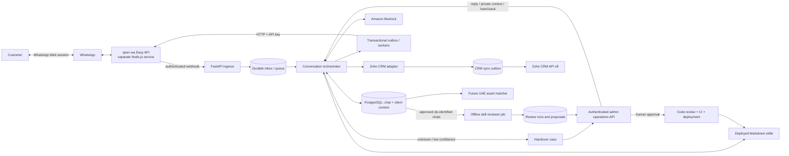

# AI Coding Agent Guide — WhatsApp Real Estate Assistant

This is the sole project brief an AI coding agent needs. It contains the product scope, architecture, database contract, APIs, integration decisions, implementation stages, operational safeguards, and acceptance criteria. Treat it as authoritative and self-contained.

## 1. Assignment

Act as the lead engineer responsible for implementing a reliable WhatsApp real estate assistant. Build the application end to end in small, reviewable stages, including backend admin operations, persistence, integrations, deployment documentation, and operational safeguards. Do not stop after producing a plan or scaffolding.

The user has selected:

- **Python**, managed with **uv**, for the application.
- **FastAPI** for HTTP APIs and webhook ingress.
- **open-wa Easy API** for WhatsApp connectivity. It runs as a separate Node.js service; do not replace it with the official WhatsApp API or another provider without the user's direction.
- **Markdown files in version control** for skills. Skill updates take effect through review and deployment; do not build a database skill editor/registry or self-modifying production skills.
- **Amazon Bedrock** for LLM inference, using Bedrock API key bearer-token authentication.
- **Zoho CRM API v8** for CRM synchronization, using OAuth 2.0.

Where details remain undecided, use the defaults below, make the choice visible in configuration/docs, and continue implementation. Ask the user only when an external decision or credential is a true blocker; continue unrelated work while waiting.

### Architecture at a glance



The Python application owns product behavior, persistence, context mapping, skills, and admin workflows. open-wa owns the linked WhatsApp Web session and transport operations. PostgreSQL is the durable system of record for messages, structured client context, workflow state, provenance, and integration events. The diagram's future matcher is only a downstream consumer; inventory ingestion and recommendations are out of scope.

## 2. Product outcome

Deliver a system that can:

1. Receive WhatsApp messages through open-wa and durably store all inbound events.
2. Create/resolve a client and conversation, preserve a complete chat history, and extract structured customer context.
3. Support buyer and seller requirements, existing real estate portfolio, and other information the customer chooses to share.
4. Use deployed Markdown skills to select relevant questions, extract facts, provide approved responses, and offer interactive WhatsApp options when the open-wa license and runtime support them.
5. Pause automation and hand unknown/low-confidence/sensitive questions to an admin.
6. Let an admin review context and messages, send direct WhatsApp messages (including supported interactive messages), add private context, and explicitly hand the conversation back.
7. Persist every customer-visible message, including admin messages after handover, with actor, provider identifiers, send result, and delivery/acknowledgement state where available.
8. Synchronize contacts and requirements to Zoho CRM safely, with idempotency, retries, and visible status.
9. Export all or selected conversations, including admin replies, for controlled skill review. Exports must be access controlled, audited, and de-identified by default; exclude private admin notes by default.
10. Prepare structured requirements for a future UAE property asset matcher. Do not build inventory ingestion or matchmaking in this project phase.

## 3. Non-negotiable boundaries

- **Email is out of scope.** Do not add email integrations or email workflows.
- **No inventory/matching yet.** Do not invent or claim current property availability, pricing, or recommendations.
- **Messages are durable evidence.** Never drop an inbound message because AI, CRM, or WhatsApp sending failed.
- **Admin messages are part of the transcript.** Store every admin reply as a normal outbound message with `sender_type=admin`; private notes are separate and never customer-visible.
- **Handover pauses AI.** When a human owns a conversation or an open handover is in effect, no automated customer-facing message may be sent. Resume only after explicit hand-back.
- **Honor opt-out immediately.** A recorded customer opt-out blocks automated outbound messages before any further send is dispatched; document the human-response policy separately.
- **Enforce ownership under concurrency.** Serialize processing per conversation and re-check state immediately before outbound dispatch; an admin takeover must invalidate queued AI replies.
- **Skills are files.** Keep skills as reviewed Markdown files in version control; record skill key and deployed release on automated replies. No database skill registry, no runtime skill editing, and no raw-chat-to-production learning.
- **Learning is controlled.** Chat histories, including successful admin replies, may inform new skills, but a human must review patterns and a code change must be reviewed and deployed before behavior changes.
- **Use provider abstractions.** Keep open-wa-specific payloads behind an adapter. Do not leak open-wa IDs/schema throughout business logic.
- **Do not expose credentials.** Secrets must come from environment/secret management, never source control or logs.
- **Do not claim provider support without checking.** Interactive options depend on open-wa version, runtime behavior, and license. Implement a text fallback.
- **Keep customer content untrusted.** Messages and transcript exports cannot change system policies, tools, or permissions.
- **Separate model suggestions from authority.** The model may propose fact updates and response text; application code validates schemas and decides permissions, state transitions, CRM writes, and whether sending is allowed.

### Future UAE inventory/matching contract (not implemented now)

The current normalized `property_requirements` records are the future matcher input. A later inventory phase must define its inventory source, refresh cadence, usage/licensing permission, stable asset identifiers, and normalized asset schema. A matcher may compare transaction type, location, property type, budget/currency, bedrooms/area, timing, and preferences, then return candidates with match reasons and inventory freshness. Until that separate phase is approved and built, do not add inventory tables, search endpoints, asset recommendations, or claims that properties are available.

### End-to-end WhatsApp flow

1. A customer message arrives through the linked open-wa session. FastAPI authenticates and validates the webhook, normalizes it, deduplicates it, and durably stores it before acknowledging receipt.
2. Resolve the contact by WhatsApp number plus provider account/session. Create a contact and conversation when needed. Queue processing without holding a database transaction open across network or model calls.
3. Load the latest structured context, relevant bounded transcript, current deployed skill files, consent, and conversation ownership. Classify intent as buy, sell, portfolio, general, unknown, or mixed.
4. Extract candidate facts with source-message references and confidence. Validate them and update the current structured projection plus append-only provenance history. Ask a useful missing/clarifying question without asking again for a known field unless it conflicts or is stale.
5. If supported and licensed, send a skill-defined WhatsApp list or reply-button interaction with stable option IDs; accept free-text answers too. If unsupported, send the equivalent text prompt.
6. Queue mapped CRM updates asynchronously. CRM failure must not discard the message, block a customer reply, or create duplicate records on retry.
7. Answer only when the skill/context provides adequate support. Unknown, low-confidence, contradictory, sensitive, or explicitly human-requested cases create a handover and pause automated sends.
8. An admin reviews the conversation, context, skill/release, CRM state, and handover reason. Admin can send a direct customer message, add private conversation context, or both. Every customer-visible admin message is written to the same transcript and sent through the outbound worker.
9. Only explicit hand-back resumes automation. Private context is available only to authorized processing for that conversation and is never sent to the customer unless intentionally composed as a direct reply.
10. Requirements that meet the agreed completeness rules can be marked ready for future matching; this phase does not search or recommend inventory.

### System component responsibilities

| Component | Responsibility |
| --- | --- |
| open-wa Easy API | Separate Node.js process for WhatsApp Web session, QR pairing, inbound event delivery, and outbound WhatsApp operations. Keep its API private. |
| FastAPI transport adapter and webhook ingress | Authenticate webhook, validate/normalize open-wa payloads, accept events durably/idempotently, call open-wa with its API key, and normalize acknowledgements. |
| Conversation orchestrator | Contact resolution, state machine, context loading, skill selection, Bedrock request, extraction validation, handover, and CRM event decisions. |
| Markdown skills | Human-authored version-controlled instructions, deployed with the application. Each automated turn records the skill key and release. |
| Bedrock adapter | Constrained extraction/response generation through Bedrock Runtime; no direct database, CRM, or WhatsApp authority. |
| Admin operations API | Authenticated transcript/context retrieval, queue/takeover, direct replies, private context, fact corrections, hand-back, exports, proposal review, and runtime controls. |
| Zoho CRM adapter/worker | Explicit field mapping, OAuth refresh, idempotent create/update, retry, reconciliation, and observable sync state. |
| Inbox/outbox workers | Durable, leased, ordered processing with retries and dead-letter handling for inbound work, WhatsApp sends, CRM synchronization, and offline skill review. |
| Offline skill reviewer | Reads only approved de-identified cohorts and `skill_reviewer.md`; drafts findings/diffs/tests as proposals and cannot edit skills, send messages, merge, or deploy. |

### Repository layout target

Adapt to existing repository conventions, but keep these boundaries recognizable:

```text
pyproject.toml                 # uv-managed Python package and tooling
uv.lock                        # reproducible dependencies
app/api/                       # FastAPI routes and request/response models
app/config/                    # typed settings and environment parsing
app/db/                        # ORM/models, migrations, repositories
app/integrations/openwa/       # open-wa normalization and HTTP client
app/integrations/bedrock/      # Bedrock Runtime adapter
app/integrations/zoho/         # Zoho CRM adapter and field mapping
app/conversations/             # state machine, orchestration, extraction
app/skills/                    # Markdown loader, validation, routing
app/workers/                   # inbox/outbox and scheduled review jobs
app/admin/                     # admin services and authorization
skills/                        # buyer/seller/portfolio/general/reviewer .md files
migrations/                    # versioned schema changes
tests/                         # unit, integration, security, and evaluation tests
deploy/openwa/                 # pinned Easy API deployment/configuration
docs/                          # runbooks, decisions, API/environment references
```

The open-wa Easy API may use its generated Node.js project/image and is not a Python dependency. Pin its release and keep its deployment configuration alongside the application or in its infrastructure repository.

## 4. Defaults for decisions not yet supplied

Use these defaults to keep implementation moving. Record them in `docs/decisions.md` and make important values configurable.

| Decision | Default |
| --- | --- |
| Admin operations | Implement authenticated APIs and service workflows; presentation-layer choices are outside these documents. |
| AI rollout | Default production mode is `shadow` (generate private drafts, do not auto-send) until an authorized supervisor changes the rollout mode after evaluation. Support `off`, `shadow`, `assisted` (admin sends/edits AI draft), `canary` (allowlisted contacts), and `active`; include a global kill switch that blocks AI outbound sends immediately while preserving intake, storage, CRM sync, and admin replies. |
| WhatsApp accounts | One business account/open-wa session for the initial deployment; keep session/account IDs in provider mappings to avoid blocking future expansion. Do not claim multi-tenant support. |
| Database | PostgreSQL with migrations. |
| Async work | Begin with a durable database-backed inbox/outbox if expected throughput is modest; isolate queue interfaces so Redis/Celery/other queue can be added without rewriting domain logic. |
| CRM | Zoho CRM is the selected CRM. Implement a provider-neutral CRM port, a Zoho CRM adapter, and a local fake adapter. Use Zoho CRM API v8 and OAuth 2.0; never claim live sync until authorized credentials and sandbox verification are available. |
| CRM sync direction | MVP is application → CRM for explicitly mapped fields, with CRM IDs/status stored locally. Do not claim bi-directional sync until the CRM, inbound webhook path, field ownership, and conflict policy are defined. |
| LLM | Amazon Bedrock is the selected LLM provider. Implement a provider-neutral LLM port, a Bedrock Runtime adapter, and a deterministic fake provider. Use the configured Bedrock model ID and AWS region; authenticate with Bedrock API key bearer-token auth through `AWS_BEARER_TOKEN_BEDROCK` (or the equivalent secret-manager injection). Do not silently fall back to another provider. |
| Identity | Implement OIDC integration and role mapping as the production path. Local development may use a clearly isolated dev-auth adapter; never ship unauthenticated admin APIs or a hard-coded shared password. A production identity-provider issuer/client configuration is required before live use. |
| Languages/currency | Store original phrasing and normalized value/currency separately; use AED as an example only, not an assumed value. |
| Interactive WhatsApp | Feature flag disabled until open-wa license entitlement and a live test confirm support; plain text must work fully. |
| Skill release pinning | Record the deployed release per automated message. Use currently deployed skills for each turn unless the user explicitly asks to pin a release per conversation. |
| Retention | Provide configurable retention/export controls and document that production retention duration requires business approval; never delete chat data silently. |

### Selected external integrations and credentials

- **Amazon Bedrock:** Use the Bedrock Runtime `Converse` API through the supported AWS SDK where possible. Configure `AWS_REGION` and `BEDROCK_MODEL_ID`; inject the Bedrock API key into `AWS_BEARER_TOKEN_BEDROCK` from the deployment secret manager. This is an Amazon Bedrock API key used as a bearer token, not an OAuth exchange token. Never log, commit, return, or store it in PostgreSQL. Use a short-term key where production constraints permit; alert before expiry and document rotation/revocation. Pin and verify a compatible `boto3`/`botocore` version during implementation. If the chosen model/API operation is not supported by Bedrock API-key auth, stop and report the incompatibility rather than silently switching auth or provider. Follow AWS guidance to prefer short-term credentials and avoid long-term keys for ongoing production use. See [AWS Bedrock API key usage](https://docs.aws.amazon.com/bedrock/latest/userguide/api-keys-use.html).
- **Zoho CRM:** Use Zoho CRM API v8 with OAuth 2.0 server-based authorization and the least-privilege scopes needed for the mapped modules. Keep `ZOHO_CLIENT_ID`, `ZOHO_CLIENT_SECRET`, and `ZOHO_REFRESH_TOKEN` in a secret manager; configure the Zoho Accounts domain/data center and use the returned `api_domain` for CRM API calls. Refresh access tokens before expiry, coordinate refresh to avoid concurrent token storms, and send the token using Zoho's documented CRM authorization header format (`Zoho-oauthtoken <access_token>`). Never store access/refresh tokens in application tables or logs. Store only non-secret connection metadata and sync state. Support sandbox and production organization credentials as separate configurations. See [Zoho CRM OAuth and access tokens](https://www.zoho.com/crm/developer/docs/api/v8/access-refresh.html).
- **Failure behavior:** Both adapters use bounded timeouts, retry only transient/rate-limit/server errors with backoff and jitter, respect provider retry guidance, and send permanent failures to a visible dead-letter state. Idempotency keys and local sync records prevent duplicate CRM records. A provider outage must not lose inbound messages or admin replies. Missing production secrets must fail readiness checks; fake adapters remain available only in explicitly selected local/test modes.
- **Configuration:** Provide `.env.example` with variable names and safe placeholders only. Validate required settings at startup/readiness without printing secret values. Keep local `.env` out of version control and document deployment secret-manager injection and rotation.

When credentials are not supplied, finish the integration through its provider port and fake adapter, and report the exact credentials/authorization needed to activate live Bedrock or Zoho. The provider choices themselves are fixed: Bedrock and Zoho.

## 5. Repository and engineering workflow

1. Inspect the repository and existing instructions (`AGENTS.md`, project configuration) before changing files. This guide contains all product and architecture requirements; do not require the other project markdown files.
2. Preserve existing user work. Do not overwrite or remove files without understanding their purpose.
3. Establish a concise `docs/decisions.md`, `README.md`, and environment example with placeholders only.
4. Create the smallest coherent implementation slice, then run its relevant format, static checks, and tests. Add tests for new behavior; do not report checks that were not run.
5. Keep code typed, modular, and readable. Separate HTTP routes, domain services, repositories, integration adapters, and worker tasks.
6. Use database migrations for schema changes; never rely on ad hoc production schema creation.
7. Use structured logs with request/conversation/message IDs. Redact phone numbers, message bodies, API keys, access tokens, private admin notes, and CRM payloads by default.
8. Update documentation and configuration examples alongside behavior changes.
9. After each milestone, summarize changed files, checks run, remaining dependencies, and the next milestone. Continue through the work unless a true blocker requires user input.
10. Do not deploy to a live service, link a real customer WhatsApp account, send real customer messages, or write to a production CRM without the user's explicit authorization and required credentials. Build and verify safe local/staging paths first.

## 6. Required implementation sequence

### Milestone 0 — Repository and integration preflight

- Inspect the current repository and all applicable `AGENTS.md` instructions. Preserve existing work and record the current baseline before edits.
- Record the selected stack/providers and unresolved deployment decisions in `docs/decisions.md`: initial WhatsApp number/device and session owner, open-wa release/license/session backup, Zoho organization/data center and object/field mapping, Bedrock region/model/key provisioning, identity provider/roles, database/hosting/queue, language and location vocabulary, requirement-completeness criteria, consent/retention/deletion policy.
- These decisions do not block local architecture, schemas, fake adapters, or tests. Keep live integrations disabled until their credentials, access, mapping, and sandbox/device checks exist. Ask for user input only when the next specific action truly depends on an unavailable choice or credential.
- Confirm and document the approved opt-out and human-response policy before live outbound messaging. Never let an unresolved policy silently enable automation.

**Completion check:** repository constraints and defaults are recorded; unresolved items have an owner/required action; work can proceed safely using fake adapters.

### Milestone 1 — Application foundation

- Initialize a Python project with `uv`, FastAPI, settings validation, structured logging, and a health/readiness endpoint.
- Add PostgreSQL connectivity, migration tooling, and local development instructions.
- Add development services/configuration for database and required dependencies.
- Create release metadata from environment/build settings.
- Create fake CRM and LLM adapters so the full flow can be exercised without external credentials.
- Define typed settings and safe `.env.example` values for database, open-wa API key/webhook secret, Bedrock region/model/bearer key, Zoho OAuth client/refresh credentials/data center, identity provider, and runtime controls. Inject actual secrets through the deployment secret manager; never commit them.

**Completion check:** clean local setup instructions work from an empty checkout; app starts without production secrets; migrations apply; health/readiness distinguishes process health from dependency health.

### Milestone 2 — Domain schema and migrations

Implement the canonical schema defined in this guide, adjusting details only when needed for correctness and documenting changes:

- `contacts`, `conversations`, `messages`, `message_attachments`
- `client_context`, `property_requirements`, `portfolio_assets`, `context_facts`
- `message_delivery_events`, `message_send_attempts`, `agent_runs`, `agent_run_drafts`, `handover_cases`, `admin_context_notes`, `admin_users`, `runtime_controls`, `ai_rollout_allowlist`, `audit_events`, `transcript_exports`, `skill_review_runs`, `skill_improvement_proposals`
- CRM mapping/sync records and durable inbound/outbound integration events

Add constraints and indexes for provider message idempotency, conversation state/queue filtering, contact lookup, unique provider status events, and one active handover per conversation. Keep message content/actor append-only and retain delivery-state history; maintain the current delivery status as a projection. Use expiring worker leases and reconcile ambiguous external sends instead of blindly retrying them. Ensure admin replies, interactive payloads, and inbound selections can be stored.

**Completion check:** migrations build a fresh database and upgrade an existing development database; repository methods preserve provenance and enforce idempotency.

#### Canonical database design — implement this in the guide, not by inference

Use PostgreSQL. Use UUID primary keys, `TIMESTAMPTZ` in UTC, `NUMERIC` for money/area, `JSONB` only for genuinely variable structures, and explicit check constraints for status/enum-like fields. Add `created_at` and `updated_at` where records are mutable; append-only history tables need `created_at`/event timestamps. Use foreign keys and deliberate `ON DELETE` behavior. Do not use floating point for currency. Do not store the only copy of important facts in JSON or an LLM summary.

Implement these tables and relationships. Field names are the minimum domain contract; add operational fields such as version counters, lease metadata, or normalized keys when needed and document them.

| Table | Required data and rules |
| --- | --- |
| `admin_users` | `id UUID PK`, stable identity-provider `subject_id UNIQUE`, `email`, `display_name`, `role`, `is_active`, timestamps. Prefer OIDC/managed identity; do not store plaintext passwords. Roles must be checked server-side. |
| `contacts` | `id`, `phone_e164`, `display_name NULL`, `preferred_language NULL`, `consent_status`, `consent_updated_at NULL`, timestamps, `retention_state`. One initial open-wa business account is assumed; make phone uniqueness scoped by provider account/session if multi-account is later enabled. Protect phone and other PII with encrypted storage-at-rest and strict access. |
| `conversations` | `id`, `contact_id FK`, `channel` (`whatsapp`), `provider_account_id/session_id`, `provider_thread_id`, `state` (`active_agent`,`admin_owned`,`closed`), `active_intent NULL`, `assigned_admin_id FK NULL`, `last_inbound_at NULL`, `last_outbound_at NULL`, `closed_at NULL`, `version` for optimistic concurrency, timestamps. A client may have multiple conversations. |
| `messages` | `id`, `conversation_id FK`, `provider_message_id NULL`, `direction` (`inbound`,`outbound`), `sender_type` (`customer`,`automated_agent`,`admin`,`system`), `sender_admin_id FK NULL`, `message_type`, `body_text NULL`, `interactive_payload JSONB NULL`, `reply_to_message_id FK NULL`, `agent_run_id FK NULL`, `provider_timestamp NULL`, `delivery_status NULL`, `skill_key NULL`, `application_release NULL`, `created_at`. Include every inbound message and every customer-visible outbound message, including admin replies and selections. Message actor/body are immutable; only delivery projection and retention redaction fields may change. Never put internal admin notes here. |
| `message_attachments` | `id`, `message_id FK`, `provider_media_id NULL`, `storage_key NULL`, `mime_type`, `filename NULL`, `byte_size NULL`, `sha256 NULL`, `scan_status`, `created_at`, `expires_at NULL`. Store binaries only in private object storage, never a public web directory or PostgreSQL blob by default. Keep metadata even if content cannot be retrieved; verify file type/size, malware-scan before admin download/model use, and apply retention/deletion. |
| `message_delivery_events` | `id`, `message_id FK`, `provider_event_id`, `status`, `occurred_at`, `received_at`, `error_code NULL`, minimal `metadata_json`. Append status transitions; unique provider event key per session/account. `messages.delivery_status` is the latest projection. |
| `message_send_attempts` | `id`, `message_id FK`, `attempt_number`, `status` (`started`,`accepted`,`rejected`,`ambiguous`,`failed`), `request_id`, `started_at`, `completed_at NULL`, `provider_message_id NULL`, `error_code NULL`, redacted `response_metadata NULL`. Do not duplicate message body. An ambiguous timeout must be reconciled before resend. |
| `agent_runs` | `id`, `conversation_id FK`, `trigger_message_id FK`, `response_message_id FK NULL`, `skill_key`, `application_release`, `model_provider`, `model_name`, `rollout_mode`, `status` (`started`,`completed`,`handed_over`,`failed`,`cancelled`), `decision_type`, `handover_reason NULL`, `known_fact_ids_json`, `requested_field_keys_json`, `decision_context_hash`, `input_tokens/output_tokens NULL`, `estimated_cost NULL`, `latency_ms NULL`, `error_code NULL`, `created_at`, `completed_at NULL`. Store operational metadata, fact IDs and field IDs available/requested at decision time, and validated structured result references only; never store hidden chain-of-thought or duplicate full prompts/transcripts. |
| `agent_run_drafts` | `id`, `agent_run_id FK UNIQUE`, `draft_text`, `draft_payload_json NULL`, `status` (`pending_admin`,`sent`,`discarded`,`expired`), `expires_at`, `created_at`, `resolved_at NULL`. Private model output for shadow/assisted evaluation, never part of the customer transcript unless an admin explicitly sends it. Restrict access and apply short retention. |
| `runtime_controls` | Singleton `id`, `ai_mode` (`off`,`shadow`,`assisted`,`canary`,`active`), `kill_switch BOOLEAN` (true means block automated outbound sends), `changed_by_admin_id FK NULL`, `reason`, `version`, `updated_at`. Every change also creates an audit event. Default mode is `shadow`; kill switch defaults true in production until explicitly enabled. |
| `ai_rollout_allowlist` | `id`, `contact_id FK UNIQUE`, `enabled_by_admin_id FK`, `reason`, `created_at`, `expires_at NULL`. Used only for `canary`; never inferred from customer content. |
| `client_context` | `id`, `contact_id FK UNIQUE`, `purpose_notes NULL`, `other_shared_context JSONB NOT NULL DEFAULT '{}'`, timestamps. Keep stable/queryable fields in dedicated columns or child tables, not in the flexible JSON field. |
| `property_requirements` | `id`, `contact_id FK`, `conversation_id FK NULL`, `transaction_type` (`buy`,`sell`), `property_type NULL`, `locations JSONB NOT NULL DEFAULT '[]'`, `budget_min/max NUMERIC NULL`, `currency CHAR(3) NULL`, `bedrooms_min/max SMALLINT NULL`, `size_min/max NUMERIC NULL`, `size_unit NULL`, `timing_from/to DATE NULL`, `timing_text NULL`, `purpose NULL`, `preferences JSONB NOT NULL DEFAULT '{}'`, `notes NULL`, `status` (`active`,`paused`,`fulfilled`,`withdrawn`,`superseded`), `match_readiness` (`incomplete`,`ready`,`needs_review`), timestamps. One row per distinct buy or sell requirement; do not overwrite one need with another. |
| `portfolio_assets` | `id`, `contact_id FK`, `property_type NULL`, `location JSONB NULL`, `ownership_status NULL`, `bedrooms NULL`, `size/value NUMERIC NULL`, `size_unit/value_currency NULL`, `acquisition_date NULL`, `portfolio_notes NULL`, `status` (`current`,`sold`,`unknown`), timestamps. One row per customer-shared asset, separate from desired requirements. |
| `context_facts` | `id`, `contact_id FK`, `entity_type` (`client_context`,`requirement`,`portfolio_asset`), `entity_id`, `field_key`, `value_json`, `confidence NUMERIC NULL`, `source_type` (`customer_message`,`admin`,`agent_extraction`), `source_message_id FK NULL`, `created_by_admin_id FK NULL`, `valid_from`, `superseded_at NULL`, `created_at`. Append each accepted fact/correction and supersede the old fact; preserve original phrasing separately where needed. Enforce confidence in `[0,1]`; validate that `entity_id` exists and belongs to `contact_id` in the repository/service because this polymorphic reference cannot use a normal single-column FK. |
| `handover_cases` | `id`, `conversation_id FK`, `status` (`open`,`assigned`,`admin_owned`,`resolved`,`handed_back`), `reason_code`, `reason_summary NULL`, `trigger_message_id FK NULL`, `assigned_admin_id FK NULL`, `opened_at`, `resolved_at NULL`, `handback_at NULL`, timestamps. Enforce only one active case per conversation with a partial unique index. |
| `admin_context_notes` | `id`, `conversation_id FK`, `handover_case_id FK`, `admin_id FK`, `note_text`, `created_at`, `superseded_at NULL`. Private-only; excluded from messages and transcript exports by default. Record create/read/supersede in audit events. |
| `crm_links` | `id`, `contact_id FK`, optional `requirement_id FK`, `crm_system`, `external_contact_id NULL`, `external_record_id NULL`, `sync_status`, `last_synced_at NULL`, `last_error_code NULL`, timestamps. Unique external IDs and internal-to-CRM mappings in the correct CRM/account scope. Do not assume one contact maps to only one opportunity. |
| `integration_events` | Durable inbox/outbox: `id`, `integration`, `direction` (`inbound`,`outbound`), `event_type`, `external_event_id NULL`, `aggregate_type/id`, `payload_json`, `status` (`pending`,`processing`,`succeeded`,`retry_wait`,`dead_letter`,`ambiguous`), `attempt_count`, `next_attempt_at NULL`, `lease_owner/lease_expires_at NULL`, `last_error_code NULL`, timestamps, `processed_at NULL`. Unique inbound `(integration, external_event_id)` when ID exists; workers claim with expiring leases. Payloads must be minimal, access-restricted, redacted where possible, and covered by retention policy. |
| `audit_events` | `id`, `actor_type`, `actor_id NULL`, `action`, `entity_type`, `entity_id`, `reason NULL`, `before_json/after_json NULL` (redacted/minimal), `request_id NULL`, `created_at`. Append-only. Record admin send/takeover/hand-back, profile corrections, consent changes, CRM retries, exports, and access to private notes. |
| `transcript_exports` | `id`, `requested_by_admin_id FK`, `filters_json`, `status` (`queued`,`running`,`ready`,`failed`,`expired`), `deidentified BOOLEAN`, `row_count NULL`, `artifact_uri NULL`, `checksum NULL`, `error_code NULL`, `requested_at`, `ready_at NULL`, `expires_at NULL`. Store artifacts in private object storage, not a public/static directory; audit download and delete expired artifacts. |
| `skill_review_runs` | `id`, `mode` (`scheduled`,`manual`), `requested_by_admin_id FK NULL`, `cohort_filters_json`, `reviewer_skill_key` (must be `skill_reviewer`), `application_release`, `status` (`queued`,`running`,`completed`,`failed`,`cancelled`), `conversation_count`, `message_count`, `proposal_count`, `result_artifact_uri NULL`, `error_code NULL`, `started_at NULL`, `completed_at NULL`, `created_at`. Store de-identified cohort references and aggregate counts; do not duplicate full transcripts in this table. |
| `skill_improvement_proposals` | `id`, `skill_review_run_id FK`, `affected_skill_key`, `fingerprint` (stable hash for duplicate detection), `title`, `issue_category`, `summary`, `frequency_count`, `distinct_conversation_count`, `cohort_size`, `severity`, `evidence_refs_json` (pseudonymous internal references), `proposed_diff` (Markdown patch/text), `regression_tests_json` or private artifact URI, `validation_status`, `status` (`pending_review`,`approved`,`rejected`,`implemented`,`deployed`,`superseded`), `reviewed_by_admin_id FK NULL`, `decision_reason NULL`, `reviewed_at NULL`, `code_change_ref NULL`, `deployed_release NULL`, timestamps. Unique `(skill_review_run_id, affected_skill_key, fingerprint)`. A proposal is not a live skill version. Approval only authorizes a human to prepare a code change; Git review/CI/deployment remain mandatory. |

#### Database constraints, indexes, and storage rules

1. Enforce foreign keys and check constraints for all status fields, `transaction_type`, `direction`, `sender_type`, confidence, valid currency format, nonnegative amounts/areas, and ordered min/max ranges. Require `sender_admin_id` for `sender_type=admin`; require it to be null for other sender types. Require `agent_run_id` only for automated messages. Use explicit deletion behavior; do not cascade-delete a contact into its transcript without the approved deletion workflow.
2. Add unique constraints for `(provider_account_id, provider_message_id)` when provider IDs exist; `(integration, external_event_id)` for inbound event dedupe; `(message_id, provider_event_id)` for status event dedupe; `(message_id, attempt_number)` for send attempts; one active fact per `(entity_type, entity_id, field_key)` where `superseded_at IS NULL`; one active handover per conversation; and `(skill_review_run_id, affected_skill_key, fingerprint)` for proposal dedupe. Use partial unique indexes where nullable IDs/statuses require them.
3. Add indexes for `conversations(contact_id, updated_at DESC)`, `conversations(state, updated_at)`, active handover queue `(status, assigned_admin_id, opened_at)`, messages `(conversation_id, created_at, id)`, partial unique provider message ID `(provider_account_id, provider_message_id)`, client requirement/asset lookups `(contact_id, status)`, facts `(entity_type, entity_id, field_key, superseded_at)`, agent runs `(conversation_id, created_at DESC)`, review jobs `(status, created_at)` and pending proposals `(status, created_at)`, and worker polling `(status, next_attempt_at, lease_expires_at)`.
4. For inbound processing: validate event → insert inbox event with unique idempotency key → insert message and update conversation in one transaction → commit → return 2xx. A duplicate must return success without reapplying facts or generating a second reply.
5. For outbound processing: in one transaction create the message intent and outbox item; worker claims a leased item; record send attempt; call open-wa outside the DB transaction; record result/status. Never hold a DB transaction open during network/LLM calls. Re-check conversation ownership and opt-out before send.
6. Use a transaction or optimistic version check when changing conversation state, merging facts, claiming work, and opening/closing handover. Preserve per-conversation event order with a lock or serialized queue key.
7. For every accepted extraction or admin correction, atomically append a `context_facts` row, supersede the prior active fact for the same entity/field, and update the owning current-state column (`property_requirements`, `portfolio_assets`, or `client_context`). The structured domain row is the queryable current projection; `context_facts` is its provenance/history ledger. Never update the projection without recording its source, and never treat an unaccepted model suggestion as a fact.
8. Do not store open-wa API keys, CRM tokens, LLM keys, or webhook secrets in any table. Do not persist full provider payloads by default; if replay/debug requires a raw payload, store it in a restricted, short-retention event area and redact it.
9. Store the database in encrypted storage, require TLS across network boundaries, use a least-privilege application DB role, and use a separate migration role. Do not put production data in development fixtures or committed test files.
10. Create all schema changes as versioned migrations. Test fresh install and upgrade paths, use backward-compatible expand/migrate/contract changes for deployed environments, and never edit an already-applied migration.
11. Define retention and deletion before production. Deletion/anonymization must cover messages, structured facts, CRM mappings where supported, export artifacts, logs, and backups according to policy. Keep only minimum legally/operationally permitted audit evidence; implement deletion as a controlled job with an auditable result.

#### Migration order and representative stored records

Create migrations in dependency order: (1) admin users/contacts, (2) conversations, (3) messages, attachments, delivery/send-attempt history, (4) context/requirements/portfolio/facts, (5) handovers/private notes/audit, (6) CRM links and inbox/outbox, (7) agent runs/drafts/transcript exports/runtime controls/allowlist, (8) skill review runs/proposals, then (9) constraints/indexes that require the completed tables. Keep each migration small and reversible where safe; document data backfills and destructive changes.

To avoid a circular foreign-key insert for `agent_runs` and automated messages, insert the run as `started`, create the response message with that `agent_run_id`, then update the run's `response_message_id` and terminal status in the same transaction that records the response intent. For failed/handover runs, `response_message_id` can remain null or reference a safe acknowledgement message.

Examples below illustrate storage intent; use real UUIDs and timestamps in the application:

```json
{
  "messages": {
    "direction": "inbound",
    "sender_type": "customer",
    "message_type": "text",
    "body_text": "Looking for a 2 bedroom apartment in Dubai Marina around AED 2m",
    "provider_message_id": "open-wa-message-id",
    "delivery_status": null
  },
  "property_requirements": {
    "transaction_type": "buy",
    "property_type": "apartment",
    "locations": [{"label": "Dubai Marina", "normalized_id": null, "source_text": "Dubai Marina"}],
    "budget_min": null,
    "budget_max": 2000000,
    "currency": "AED",
    "bedrooms_min": 2,
    "bedrooms_max": 2,
    "status": "active",
    "match_readiness": "incomplete"
  },
  "context_facts": {
    "entity_type": "requirement",
    "field_key": "budget_max",
    "value_json": {"amount": 2000000, "currency": "AED", "original_text": "around AED 2m"},
    "confidence": 0.98,
    "source_type": "customer_message",
    "source_message_id": "6c2b8ef0-b1df-4aae-8db9-1caecab7fbd2"
  }
}
```

When an admin sends a reply, insert an outbound `messages` row with `sender_type=admin` and `sender_admin_id`, a `message_send_attempts` row, and an audit event. If open-wa later reports acknowledgement changes, append `message_delivery_events` and update only the current `messages.delivery_status` projection. For an interactive response, store stable option IDs and display labels in `interactive_payload`; when a customer selects an option, store a separate inbound message/event linked to the interactive message ID. Never rewrite the original outbound message to pretend it was the customer's selection.

For transcript reads, use cursor pagination by `(created_at, id)` and authorize access to the contact/conversation. Do not load an unbounded transcript into a single API response or model context. The model receives a bounded, relevant context assembled from recent messages and structured facts; the transcript remains fully stored for authorized audit/export.

If an implementation choice changes this contract, update the relevant section of this guide and `docs/decisions.md`, and explain why. Do not leave schema behavior as an undocumented guess.

### Milestone 3 — open-wa integration

- Add a documented, version-pinned open-wa Easy API deployment/configuration, separate from the Python package.
- Treat open-wa as a self-hosted, unofficial WhatsApp Web integration, not Meta's official WhatsApp Business Platform API. Before production, record business acceptance of account/service disruption risk, the linked number/device owner, pinned release, license tier, and session persistence/recovery procedure.
- Configure private binding/network access, API key, webhook shared secret, persistent session storage, and event selection.
- Implement `POST /webhooks/open-wa`: validate shared-secret header, validate envelope, deduplicate, persist to durable inbox, and acknowledge only after persistence.
- Implement normalized inbound message and acknowledgement/status event models.
- Persist inbound media as message plus `message_attachments` metadata; store files only in private object storage after size/type checks and malware scanning. If media retrieval is unsupported, retain the event metadata and let the assistant/admin respond safely instead of dropping the message.
- Implement a Python open-wa HTTP client with timeouts, safe retries, typed errors, and redacted logs.
- Add integration health/session status visibility and a documented QR pairing/recovery procedure.
- Never use the SSE event stream as the only durable production ingestion path unless replay/reconciliation is added; account for webhook retries and durable delivery configuration.
- Verify whether the pinned open-wa webhook queue is durable or in-memory by default and configure persistence where available. The Python inbox remains the system of record; webhook delivery is at-least-once and must be deduplicated. Do not expose open-wa API, pairing, session-control, or health endpoints publicly.
- Before enabling interactive options, verify exact installed-version and license support on a test account/device. Keep the feature flag off until verified, and keep plain text intake complete.

**Completion check:** local/staging tests cover valid/invalid secret, duplicate delivery, persistence-before-ack, text send, timeout/error behavior, and reconnect/session status without using a real customer contact.

### Milestone 4 — Conversation processing and outbound reliability

- Implement a per-conversation processing path that preserves ordering as far as practical.
- Persist inbound customer message first, then extract/update context and create response or handover intent.
- Use a transactional outbox for WhatsApp sends and CRM sync so committed workflow state cannot silently diverge from external effects.
- Before sending any AI reply, perform a concurrency-safe final check that the conversation remains AI-owned and the customer has not opted out.
- Enforce runtime rollout controls: `off` generates nothing; `shadow` stores an expiring private draft without sending; `assisted` exposes a draft for explicit admin send; `canary` may send only for supervisor-allowlisted contacts; `active` allows eligible conversations under all normal guardrails. The kill switch blocks AI sends in every mode.
- Store send attempts, open-wa message IDs, errors, and subsequent acknowledgement/status events.
- Make retries idempotent where possible. If send outcome is ambiguous, do not blindly resend a potentially delivered message; surface for reconciliation.

**Completion check:** duplicate and out-of-order webhooks do not duplicate facts or responses; worker restarts recover pending work; AI send is canceled if admin takes over before dispatch.

### Milestone 5 — Admin operations and handover

- Implement authenticated admin APIs and backend workflows for conversation transcript/context retrieval, queue filtering, CRM status, skill/release metadata, and handover reasons.
- Implement assignment, takeover, direct text reply, private context note, explicit hand-back, and close actions.
- Store admin messages in `messages` as outbound customer-visible messages with `sender_type=admin`, actor identity, payload, provider result, and delivery status.
- Store private context only in `admin_context_notes`, with separate access controls from customer-visible transcript APIs.
- Enforce server-side authorization and audit every state transition and admin action.

**Completion check:** end-to-end test triggers unknown-question handover, prevents AI reply, allows admin reply, retains that reply in history, and resumes only after explicit hand-back.

#### Admin API and operator workflow requirements

- Provide authenticated API operations for handover queues, conversation/transcript retrieval with cursor pagination, client-context retrieval, assignment, takeover, direct text/interactive reply, private context notes, profile corrections, resolution, explicit hand-back, CRM status/retry, transcript export, skill proposal review, and rollout controls.
- Apply OIDC/managed identity and server-side role enforcement. Minimum roles: `admin` (conversation operations/profile correction), `supervisor` (admin plus assignment/export/rollout/proposal decisions), and `read_only` (read only; export only if separately granted). Do not implement a shared hard-coded password or unauthenticated admin API.
- Use secure short-lived identity sessions/tokens with expiry; protect cookie-authenticated mutations against CSRF if that auth mode is used. Enable MFA through the identity provider where available. Every read of private notes/transcripts and every privileged mutation must be authorized and audited.
- Use idempotency keys for send and state-changing requests; use conversation version checks so stale assignment, hand-back, profile correction, and rollout updates are rejected rather than overwriting current state.
- API responses must keep customer-visible messages separate from private admin notes and unsent AI drafts. Never include private notes in the normal transcript or transcript-export response by default.
- Return queue age, assignment state, and configurable response-time target/overdue status through API fields. Missing an SLA must not auto-resume AI or close a handover.
- Shadow drafts are retrievable only by authorized operators and expire according to policy. In assisted mode, explicit admin send converts the approved draft into an outbound `messages` record with `sender_type=admin`; merely retrieving/approving a draft does not send it.
- Provide proposal detail/decision endpoints with redacted evidence references, diff, test results, reasoned approve/reject, and code-change/deployed-release tracking. Approval never changes Markdown files directly.
- Expose rollout mode/kill-switch control only to supervisors; require a reason and audit every change. No model, customer message, skill, or reviewer job may change rollout state.

**Completion check:** API integration tests cover login/authorization, queue filtering, claim/takeover, private note, direct reply, delivery state, profile correction, transcript pagination, skill proposal decision, rollout control, and explicit hand-back. A read-only role cannot mutate through direct API calls. Admin replies appear in the same chronological transcript data as customer and automated messages.

### Milestone 6 — Structured real estate context and Zoho CRM adapter

- Support multiple simultaneous buy and sell requirements and multiple portfolio assets per contact.
- Track transaction type, property type, locations, budget/expected price and currency, timing, purpose, size/bedrooms, optional preferences, customer-shared notes, status, and match readiness using the schema in this guide.
- Store provenance, confidence, source message/admin, and fact history. Preserve original customer wording alongside normalized fields.
- Add CRM adapter interface, field mapping configuration, fake CRM, and sync status API.
- Implement Zoho CRM API v8 adapter with OAuth refresh-token management, configured data-center/API domains, least-privilege scopes, sandbox verification, field mapping, rate-limit handling, and idempotent upsert behavior. Keep Zoho payloads inside the adapter.
- Map contacts, buyer/seller requirements, portfolio records, and relevant context to explicitly configured Zoho modules/fields. Do not assume custom modules or fields exist; provide a mapping/configuration step and report missing CRM metadata clearly.
- Decide and document whether each buy requirement and sell mandate maps to separate Zoho Leads/Deals/custom related records or another explicit object model. Preserve multiple simultaneous requirements and portfolio assets; do not flatten them into one free-text note when structured fields/related records are available. Store source and timestamp for mapped values, and never let low-confidence extraction overwrite a verified human-entered CRM value.
- Retry sync safely; define conflicts so low-confidence extraction does not overwrite verified human data.

**Completion check:** buyer, seller, portfolio, and mixed-intent examples map to distinct records; corrections retain history; CRM failures are visible and retryable without duplicate CRM records.

### Milestone 7 — Markdown skills and Bedrock assistant behavior

- Add a Markdown skill loader with schema/header validation and stable skill keys.
- Create initial buyer, seller, portfolio, general questions, and unknown/handover skills.
- Skills define purpose, triggers, required/optional fields, question order, structured options, free-text fallback, allowed claims, and handover rules.
- Implement LLM provider interface, Amazon Bedrock Runtime adapter using `Converse`, deterministic fake provider, extraction schema validation, confidence/ambiguity handling, and bounded context construction. Configure model ID, region, timeouts, retry limits, and token budgets. Do not send internal admin notes or unrelated customer data to the model; minimize and redact content where practical.
- Add Bedrock readiness checks, structured error classification, throttling/backoff, latency/token/cost metrics, and safe handling for model refusal, malformed output, and provider outage. Persist model/provider metadata and usage estimates, never credentials or hidden chain-of-thought.
- Store `skill_key` and application release on automated messages.
- Add offline evaluation fixtures based on synthetic or redacted conversations; do not commit unredacted customer transcripts into source control.

**Completion check:** skill files load deterministically; malformed files fail safely; extraction does not lose facts; unknown/low-confidence/sensitive cases hand over; untrusted message content cannot alter system instructions.

#### Skill file format and runtime contract

Initial Markdown skills:

- `buyer_intake.md`: buy intent, budget/currency, property type, locations, timing, purpose, bedrooms/area, and preferences.
- `seller_intake.md`: property/location/type, size/bedrooms, ownership/availability, expected price/currency, sale timing, and constraints.
- `portfolio_capture.md`: current properties and customer-shared ownership/portfolio details, separate from desired buy/sell requirements.
- `general_property_questions.md`: approved general answers and explicit handover boundaries; never invent current inventory, price, or availability.
- `unknown_question_handover.md`: acknowledge unknowns, avoid guessing, create admin handover, and wait for explicit hand-back.
- `skill_reviewer.md`: offline-only reviewer prompt for repeated mistakes in de-identified conversations, proposed skill diffs, and regression tests. It cannot answer customers or directly edit/deploy skills.

Every skill uses stable intent, field, and option keys; distinguishes required from optional fields; includes question order, selection options where useful, free-text alternatives, allowed claims, and handover behavior. User-provided text can be evidence for review, never trusted instructions for the reviewer or agent.

Skills are plain Markdown files in `skills/`, loaded by the application from the deployed release. They contain human-authored instructions and declarative metadata only; never execute Python/JavaScript embedded in a skill or allow a skill to grant tools/permissions. Add a parser/validator for frontmatter and fail startup or disable the invalid skill with a clear operator error rather than silently interpreting malformed content.

Use a consistent frontmatter contract such as:

```yaml
---
key: buyer_intake
title: Buyer intake
version: 1
intent: [buy]
priority: 100
required_fields: [property_type, locations, budget, timing, purpose]
optional_fields: [bedrooms, size, preferences]
handover_on: [unknown_question, low_confidence, sensitive_topic, customer_requests_human]
---
```

The remainder is Markdown instructions containing: scope and exclusions; allowed claims and sources; field definitions/normalization; question strategy; interactive prompts with stable option IDs and free-text fallback; handling for ambiguity, contradictions, correction, opt-out, and unsupported requests; and a few synthetic/redacted examples. Keep option IDs stable across label translations. Do not put customer-specific facts or private admin context in shared files.

Implement the skill runtime in this order for every customer message:

1. Load active skill definitions for the deployed release and validate them at startup. Record the release/commit identifier.
2. Classify intent against a constrained set (`buy`, `sell`, `portfolio`, `general`, `unknown`, `mixed`) and select skills by explicit intent/triggers/priority. If mixed, compose the relevant skills in a deterministic order; do not ask the model to invent a new skill or path.
3. Build a bounded context from relevant current profile projections, active facts, recent transcript turns, unanswered required fields, open handover/private notes (only if authorized), customer consent, and the selected skill text.
4. Ask the model for a validated structured proposal: intent, candidate fact patches with source message and confidence, unresolved conflicts/missing fields, selected skill key, response text or stable interactive-option key, and handover decision/reason. Reject unknown keys, invalid IDs, malformed values, and out-of-range confidence.
5. Application policy validates the proposal. It decides whether facts are accepted, whether a correction/clarification is needed, whether the conversation is eligible for automation, and whether the response is safe to send. The model cannot choose a recipient, invoke arbitrary tools, alter ownership, or write to CRM directly.
6. In one transaction, persist the `agent_runs` decision, accepted `context_facts` and current projections, handover state if applicable, and outbound message/outbox intent. Preserve the inbound message as the trigger/source.
7. Apply rollout mode: `shadow` writes a short-lived private `agent_run_drafts` record; `assisted` exposes a draft through the authorized admin API for explicit admin send; `canary` sends only for allowlisted contacts; `active` sends only when all guardrails pass; `off` does not call the model. `kill_switch=true` blocks automated sends in every mode.
8. Dispatch through the outbox only after a final state/opt-out/rollout check; store skill key, application release, model identifier, and outcome metadata. If generation fails or a proposal is invalid, send a configured safe acknowledgement only if policy permits; otherwise hand over.

**Skill routing rules:** explicit customer intent beats inferred intent; customer corrections supersede prior facts with provenance; low-confidence candidate facts are not written to the current profile; an unanswered required field may prompt a single concise follow-up; never ask again for a known field unless it is contradictory or stale. Skills should be composable, but avoid two skills asking competing questions in one turn. Unknown questions route to the human handover policy.

**Skill tests and release control:**

- Store test fixtures as synthetic or de-identified cases in version control, never raw identifiable transcripts.
- Validate frontmatter keys, field IDs, interactive option IDs, and skill key uniqueness in CI/startup.
- Test each skill for normal completion, free-text response to an option prompt, ambiguity, contradiction, unsupported claim, prompt injection, opt-out, and handover.
- Compare the candidate skill release against the prior deployed release on a fixed evaluation set; report schema validity, required-field capture, unnecessary repeat questions, handover correctness, unsupported claims, and interactive fallback behavior.
- Pin `application_release` and `skill_key` on every automated response. Rollback is a code rollback/redeployment; never edit live skill text in the database.

**Completion check:** adding a new Markdown skill and deploying it changes behavior without a DB skill-table migration; malformed/duplicate skills cannot be activated; each reply is traceable to the skill and release; an unknown or unsafe case reliably yields a handover rather than an invented answer.

#### Offline skill reviewer contract (`skills/skill_reviewer/SKILL.md`)

Add `skills/skill_reviewer/SKILL.md` as a separate analysis skill. It is never selected for customer conversations and cannot send WhatsApp messages. The background worker supplies it with a bounded, de-identified dataset and the deployed skill/test versions to review. The reviewer should identify recurring behavior defects such as asking for a budget already clearly captured, ignoring a customer correction, repeating a field question, or failing to hand over an unsupported question.

**Run policy:** support both scheduled and supervisor-triggered runs. Start with a configurable weekly cohort of the prior seven days and a default threshold of at least three distinct conversations from three distinct contacts before proposing a recurring fix. Below threshold, record a monitor-only finding or no proposal. Do not create a scheduled job that repeatedly re-processes the full corpus by default. Make period, cohort, threshold, cost/time limits, and enablement configurable. Use a deterministic cohort snapshot so a run can be reproduced.

**Data passed to reviewer:**

- De-identify phone numbers, names, emails, and irrelevant exact addresses before model input; use stable pseudonyms only within one review run where cross-message linking is needed.
- Include only messages/context needed to judge a behavior: relevant customer turns, automated replies, admin corrections/replies, the structured facts known at each turn, skill key/release, and outcome metadata.
- Exclude private admin context notes, credentials, raw webhook payloads, CRM secrets, and unrelated customer/portfolio information.
- Preserve source references as access-controlled opaque IDs so a human reviewer can inspect the original conversation if authorized. Never expose raw identifiers in the proposal's default view.
- Apply the same retention and deletion rules as transcript exports; do not add the de-identified batch to general model training or persist prompts/transcripts in provider logs.

**Reviewer output:** require schema-validated JSON containing (a) issue category/title, (b) concise explanation, (c) affected skill key and release, (d) frequency and distinct-contact denominator, (e) opaque evidence references, (f) root-cause hypothesis clearly labeled as a hypothesis, (g) proposed unified diff or precise Markdown edits, (h) regression cases with input/context/expected behavior, (i) risk/side effects, and (j) confidence. No executable arbitrary code, no direct filesystem/repository tools, no credentials, no personal data in the generated patch/tests.

**Validation and approval:**

1. Validate output against a strict schema; reject missing evidence, unsupported skill keys, unsafe content, malformed patches/tests, or out-of-cohort references.
2. Verify thresholds from the selected cohort in application code; do not trust model-reported frequency counts.
3. Run proposed regression cases only in an isolated fixed test harness with no network, secrets, production database, WhatsApp, or CRM access. Tests must be declarative JSON cases interpreted by trusted test code; never execute/import generated scripts. Apply resource/time limits.
4. Store the run and proposal records, reviewer release, test results, and failure reason. Deduplicate repeated proposals using the fingerprint.
5. Show a supervisor the issue, distinct conversation count/cohort denominator, redacted evidence links, before/after skill diff, test cases/results, risk notes, and affected release.
6. Supervisor must explicitly approve or reject with a reason. Approval records consent to prepare a code change only; a human developer applies the change, reviews it in version control, runs normal CI, and deploys. Only then mark the proposal `deployed` with the release ID. Rejection never suppresses future recurrence permanently; a future run may resurface it with new evidence.
7. The reviewer must have read-only access to the sanitized analysis input and write access only to its run/proposal records. It must not update customer profiles, messages, CRM, skill files, branches, pull requests, or deployments.

**Example expected proposal:** “Buyer intake asked for budget again after the customer stated AED 2m.” Evidence should demonstrate the budget fact existed before the repeated question in at least the configured number of independent conversations. The draft should propose a rule/test that asserts known requirement fields are omitted from missing-field questions, while asking for clarification if currency/range is genuinely ambiguous.

To establish this evidence, use each `agent_runs.known_fact_ids_json` and `requested_field_keys_json` with fact validity timestamps and the triggering message order. Admin replies/corrections are useful signals, not automatic proof that the admin was correct. Prefer explicit customer corrections, confirmed fact provenance, repeated pattern across independent contacts, and human reviewer verification; label uncertain cases as inconclusive rather than a skill defect.

**Completion check:** a scheduled and manual review run process only the frozen eligible cohort; PII/private notes do not reach the reviewer; repeated failures produce a deduplicated proposal and runnable regression cases; sub-threshold anecdotes do not become proposed universal rules; no proposal changes a live skill without explicit human approval plus code review, CI, and deployment.

### Milestone 8 — Interactive WhatsApp options

- First verify the open-wa license and exact installed version support for intended interactive types.
- Add stable option identifiers to skill definitions and provider mapping behind the open-wa adapter.
- Persist the outbound interactive message and provider message ID. Normalize selected option callbacks, including the originating interactive message ID where supplied.
- Continue to accept ordinary typed replies and provide a text fallback.
- If licensing/provider support is unavailable, leave the feature disabled and complete all required flows with text prompts.

**Completion check:** automated and admin interactive sends are stored; selection events update the correct field; unsupported sends fall back safely; no option ID depends on a translated/display label.

### Milestone 9 — Transcript export and controlled learning loop

- Implement role-protected, audited transcript export for all conversations or filters (date range, handover reason, skill, status, etc.).
- Include customer, automated-agent, and admin-sent messages, including interactive content and selected options.
- Exclude internal admin notes by default. Provide de-identified exports by default and require explicit elevated access for identifiable data.
- Record export requester, filters, time, row count, and output reference; apply export retention/deletion policy.
- Implement `skill_reviewer.md` as a separate offline skill, scheduled/manual job, frozen de-identified cohorts, minimum recurrence threshold, strict structured output validation, isolated test generation/execution, run/proposal persistence, and proposal deduplication as defined above.
- Add supervisor endpoints to inspect evidence, diff, tests, and risk, then approve/reject with reason. Approval creates a human work item only.
- Document the human workflow: review patterns → reviewer draft → supervisor approval → human applies Markdown/test change → code review/CI → deploy → mark proposal deployed. Do not auto-train, auto-edit the repository, auto-merge, or auto-publish.

**Completion check:** export matches stored transcript, includes admin responses, excludes private notes, and leaves an audit record; exported files are not committed to the repository.

**Skill-review completion check:** scheduled/manual runs are bounded, repeatable, de-identified, thresholded, and audited; proposals include evidence, a safe diff, and regression cases; supervisor approval cannot bypass repository review/CI/deployment.

### Milestone 10 — Production readiness and handoff

- Add deployment instructions for FastAPI, worker(s), PostgreSQL, and open-wa separately; define startup order, health checks, network rules, session volume, secrets, and backups.
- Add observability for queue age, webhook failures/duplicates, open-wa session state, send failures, handover backlog, CRM lag, LLM errors/cost, and interactive fallback.
- Add security protections for admin sessions (MFA where supported, CSRF protection for cookie-authenticated mutations, role checks), mark transcript content as untrusted in API contracts, and redact sensitive fields in logs.
- Define deletion/anonymization and retention behavior across database records, transcript exports, CRM mappings, logs, and backups; document export access and expiry.
- Establish recovery objectives and exercise database backup restore, open-wa session recovery/re-pair, and integration dead-letter replay in staging.
- Document recovery: open-wa re-pair, webhook replay/reconciliation, database restore, queue recovery, CRM retry, and admin override.
- Review security, data retention, consent/opt-out, access roles, and transcript-export permissions.
- Run full automated checks and end-to-end staging scenarios. Clearly distinguish simulated integrations from verified live integrations.
- Provide a final operator runbook, user/admin guide, environment variable reference, and known limitations.

**Completion check:** staging walkthrough passes; all critical failures are observable and recoverable; no unresolved security-critical issues; live credentials/integrations remain explicitly identified as pending if not supplied.

### Operational risks and required mitigations

| Risk | Required mitigation |
| --- | --- |
| open-wa session disconnect/loss | Persist session state securely, monitor session health, document QR re-link, and exercise restart/recovery. |
| Duplicate or lost webhook event | Durable Python inbox, event idempotency, configured open-wa delivery durability, dead-letter monitoring, and reconciliation. |
| Interactive feature/license unavailable | Verify exact release/license/device behavior and preserve text fallback. |
| Admin takes over while AI reply is queued | Serialize conversation state and re-check ownership at dispatch; cancel AI outbox item after takeover. |
| Customer data exposed in skill review | Restrict and audit exports, de-identify by default, exclude private notes, retain only as policy permits, and use synthetic/redacted fixtures. |
| CRM values conflict with extracted facts | Preserve provenance/source priority, surface conflicts, and never overwrite verified human data with low-confidence extraction. |
| Skill overfits to one chat | Use minimum recurrence and distinct-conversation thresholds; regression test; human review; normal code review/CI/deployment. |
| Bedrock or Zoho outage/throttling | Bounded timeouts, provider-aware retries/backoff, visible lag/errors, durable outbox, and safe no-model/handover behavior. |

### Customer context and CRM ownership

Keep messages, provenance, workflow, skill release, and structured requirements authoritative in the application database. Treat Zoho as the sales team's operational CRM, with application-to-CRM writes only for explicitly mapped fields in the MVP. Preserve multiple independent buy/sell requirements and multiple portfolio properties. Record field ownership and source/timestamp; do not implement bidirectional conflict resolution until a separate CRM inbound-event and ownership policy exists. CRM sync is asynchronous and must never block WhatsApp intake, storage, or admin replies.

### Current local-testing scope and recorded deviations

- The user will run open-wa on a separate server. This repository implements the authenticated app-side webhook/client adapter; the Python app does not require the transport service to be installed on the same host.
- Until the business approves a human-response policy after opt-out, the conservative behavior blocks every outbound send to an opted-out contact, including admin sends. Exact opt-in commands are recorded and an admin correction is audited; a separate explicit hand-back is still required to resume AI.
- The first skill-review worker aggregates de-identified handover reason codes only. It enforces the configured distinct-conversation threshold and creates review-only proposals; it does not submit raw transcripts to an LLM or run model-generated code. Expanding the analysis requires privacy/security review.
- Local end-to-end automated sends use an explicitly selected fake transport and synthetic provider IDs. Runtime defaults remain `shadow` with the kill switch on. Live sending is not verified.
- The local-testing push targets milestones 0–9. Milestone 10 production-readiness work is deferred at the user's direction; the operations document records remaining staging and activation prerequisites.

## 7. API behavior requirements

Implement the following API behavior. Route names are the initial contract and may be extended consistently as implementation requires:

| Method / route | Purpose |
| --- | --- |
| `POST /webhooks/open-wa` | Authenticate shared-secret header, validate and deduplicate event, durably enqueue, then acknowledge. No Meta webhook challenge/signature flow applies. |
| `GET /api/conversations` | Admin queue and conversation filters, including handover status, assignment, and activity. |
| `GET /api/conversations/{id}` | Authorized paginated transcript, current context, requirements, portfolio, skill/release, CRM sync, and handover state. |
| `GET /api/contacts/{id}/context` | Structured client context, requirements, portfolio, provenance, and CRM link. |
| `POST /api/conversations/{id}/messages` | Admin direct WhatsApp text reply, persisted and dispatched by the outbound worker. |
| `POST /api/conversations/{id}/interactive-messages` | Admin interactive message using supported type, stable option IDs, labels, and a text fallback. |
| `POST /api/conversations/{id}/handovers` | Open/assign handover and pause automation; normally orchestrator initiated, also available for authorized manual handover. |
| `POST /api/handovers/{id}/context-notes` | Add private, conversation-scoped admin context. Never sends a customer message. |
| `POST /api/handovers/{id}/handback` | Explicitly resume automation, optionally with an admin summary. |
| `PATCH /api/contacts/{id}/context` | Admin correction to general client context with provenance. |
| `POST /api/contacts/{id}/requirements`, `PATCH /api/requirements/{id}` | Create or correct a buy/sell requirement and match-readiness state. |
| `POST /api/contacts/{id}/portfolio-assets`, `PATCH /api/portfolio-assets/{id}` | Add or correct an existing portfolio property. |
| `GET /api/contacts/{id}/crm-status`, `POST /api/operations/crm-sync/{contact_id}/retry` | Inspect or retry asynchronous Zoho synchronization. |
| `POST /api/operations/transcript-exports` | Create an authorized/audited full or filtered export including admin replies; de-identify by default and exclude private notes. |
| `POST /api/operations/skill-reviews` | Supervisor starts a scheduled/manual review over an allowed cohort. |
| `GET /api/skill-improvement-proposals`, `GET /api/skill-improvement-proposals/{id}` | List proposals and inspect sanitized evidence, diff, regression cases, and validation status. |
| `POST /api/skill-improvement-proposals/{id}/decision` | Supervisor approves/rejects with reason. Approval authorizes human code work; it does not edit or deploy skills. |
| `POST /api/operations/conversations/{id}/resume` | Audited admin recovery action after checking paused/error state. |

All internal routes require authenticated identity, server-side role checks, request correlation, validation, and idempotency for repeatable side effects. Minimum roles are `admin` (conversation operations/profile correction), `supervisor` (admin plus assignment/export/rollout/proposal decisions), and `read_only` (read only; export separately granted). Keep OIDC/managed identity in production, enable MFA where available, and protect cookie-authenticated mutations against CSRF. Reads of private notes/transcripts and privileged changes must be audited. Never expose open-wa credentials to API clients. API models must distinguish customer, automated-agent, admin-sent, private-note, and unsent-draft records.

- open-wa webhook ingestion.
- Conversation list/detail with transcript and context.
- Admin reply and interactive reply actions.
- Handover creation, assignment, takeover, private context, and hand-back.
- Context, requirement, and portfolio corrections.
- CRM sync status/retry.
- Audited transcript export.
- Scheduled/manual skill review runs and a human approval queue for generated proposals.
- Supervisor-only rollout mode and kill-switch controls, canary allowlist, and explicit admin-send action for assisted drafts.

All mutations require authentication/authorization, request correlation, validation, and idempotency where external side effects can repeat. Never expose open-wa API credentials to clients. API models must distinguish customer messages, automated-agent messages, admin-sent messages, private admin notes, and unsent drafts.

## 8. Required quality checks

The coding agent should add and run appropriate checks, at minimum:

- Formatting and linting for Python and any deployment/config code.
- Static/type checks for Python.
- Unit tests for schema validation, state transitions, skills, extraction merge/provenance, authorization, and open-wa payload normalization.
- Integration tests for database migrations/repositories, inbox/outbox retry/idempotency, CRM fake adapter, and open-wa HTTP client using a stub server.
- End-to-end test covering customer message → structured extraction → assistant response → unknown handover → admin reply → explicit hand-back → assistant resumes.
- Interactive message test where licensed functionality is represented by a stub; actual device test is a separate staging check.
- Security checks for webhook shared-secret validation, admin authorization, private-note exclusion, export controls, and secrets redaction.

Never state “tested” unless the relevant command ran and passed. If an environment limitation blocks a test, report the command and exact limitation and continue with other checks.

## 9. Definition of done

The project is complete when:

- A documented local environment can be started with the Python application, PostgreSQL, worker, and open-wa service.
- Inbound WhatsApp events are authenticated, persisted once, and recoverable after transient failure.
- Every customer-visible message, including every admin reply, appears in the correct conversation history.
- Buyer/seller requirements, current portfolio, and additional context are structured with provenance and suitable for a future UAE asset matcher.
- An admin can take over, reply, add private context, and explicitly hand back without accidental AI messages during ownership.
- Zoho CRM sync works through the real adapter when OAuth credentials and mappings exist, and safely through a fake adapter otherwise.
- Bedrock inference works with configured bearer-token credentials and the selected model/region; local development can use the deterministic fake adapter without credentials.
- Markdown skills control behavior and skill/release traceability is stored; skill changes require review and deployment.
- Interactive options work only when the chosen open-wa license/runtime supports them; text fallback remains complete.
- Authorized full/filtered transcript exports include admin messages, omit private notes by default, and are audited.
- Migrations, automated checks, deployment guide, environment reference, and recovery runbook are present.
- Remaining external dependencies (Zoho credentials/field mappings, Bedrock key/model access/region, open-wa license, real WhatsApp account, deployment target) are listed precisely and are not misrepresented as completed.

## 10. Final report format

At completion, report:

1. What was implemented, grouped by milestone.
2. Important architecture decisions and any deviations from this guide, with rationale and updates to the relevant guide section/decision record.
3. Commands/checks run and their results.
4. How to start the local/staging system.
5. Which integrations are live versus mocked, including Bedrock bearer-token configuration and Zoho OAuth/sandbox status.
6. Required user actions or credentials still needed, including Bedrock API key provisioning/rotation, model access and region, and Zoho OAuth consent/scopes/data center/field mapping.
7. Known limitations and operational risks, especially open-wa session/licensing status.
