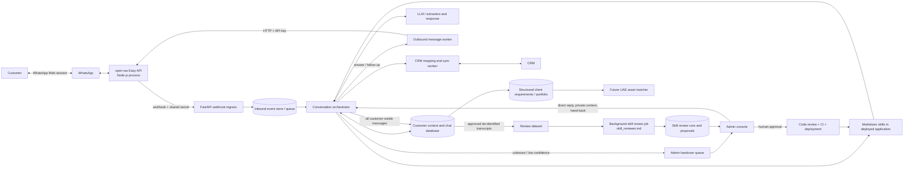

# WhatsApp Real Estate Agent — Architecture Proposal

**Status:** For architecture review  
**Scope:** WhatsApp automation using open-wa, a Python/uv/FastAPI application, CRM synchronization, and customer context mapping. Email is excluded.  
**Future extension:** Match structured client requirements against UAE property assets. Inventory ingestion and matchmaking are later phases; this phase prepares compatible data and APIs without claiming to search live inventory.

**Initial deployment assumption:** one business account/open-wa session. Keep account/session identifiers on provider-facing records so a future multi-account deployment can scope identities and idempotency keys correctly; do not imply multi-tenant isolation until it is implemented and tested.

## 1. Product model

A customer starts or continues a WhatsApp conversation. A conversational agent uses the currently published set of skills to understand the customer's goal, ask relevant follow-up questions, and maintain a structured client context. The customer can be a buyer, seller, or both. The system stores the full chat history and maps facts from that history into CRM and customer context records.

Skills are Markdown files in the code repository (for example, `buyer_intake.md`, `seller_intake.md`, `portfolio_capture.md`, `general_property_questions.md`, and `skill_reviewer.md`). The first four guide customer-facing conversations. `skill_reviewer.md` is an offline analysis skill run by a background job over approved, de-identified transcripts. It looks for recurring mistakes and drafts a proposed Markdown change plus regression tests. It cannot edit deployed skill files, merge code, or deploy. An authorized human reviews and approves/rejects the proposal; approved fixes still go through code review, tests, and deployment before changing live behavior.

When the agent cannot answer confidently, encounters an unknown question, or needs an admin decision, it pauses automated replies and creates a handover. Every admin message sent to the customer is stored in the same durable conversation history as customer and automated messages, including its provider ID, delivery status, and interactive payload where applicable. An admin can also provide private context for the assistant to use. The assistant resumes only after an explicit admin hand-back. Private admin context is not sent to the customer unless the admin deliberately turns it into a reply.

The team can extract conversation history, including admin replies, to review successful handling patterns and develop new Markdown skills. Chat patterns are evidence for a human-authored skill change, which is reviewed, tested, committed, and deployed; live conversations do not automatically train or publish skills.

## 2. Visible architecture diagram



`CDB` represents the structured context tables in the application database, not a separate database. `LEARN` is a restricted, de-identified review dataset. The skill reviewer proposes changes; a human approval and the normal code/CI/deployment path are required before production skills change. The future matcher is shown as a downstream consumer only; inventory and matching are not part of the current WhatsApp delivery scope.

## 3. WhatsApp conversation flow

1. **Receive:** Customer messages the WhatsApp number linked to open-wa. FastAPI validates the configured webhook shared secret, normalizes and deduplicates the open-wa event, and persists it before acknowledging receipt.
2. **Identify:** Resolve the contact by WhatsApp number and open-wa session. Create a contact/conversation when needed. Link a CRM record if a stable match exists; otherwise create a CRM lead according to the agreed CRM mapping policy.
3. **Understand intent:** Classify the conversation as buying, selling, portfolio sharing, general enquiry, or unclear. Load relevant customer context and the Markdown skill from the deployed release selected for the turn.
4. **Extract and ask:** Store the inbound message, extract candidate facts with source and confidence, update structured context, and ask the most useful missing or clarifying question. Where licensed and supported, send an open-wa interactive list or reply buttons (for example, Buy / Sell / Both, or a short set of locations). Consider longer structured forms only after validating support and license. Keep a text fallback and allow free-form answers. Do not repeat fields already answered unless clarification is needed.
5. **Synchronize:** Queue CRM create/update events for meaningful contact, intent, requirement, portfolio, and consent changes. CRM failure must not discard the message or conversation update.
6. **Answer or hand over:** If the question is in-skill and sufficiently supported, respond. If unknown, low-confidence, sensitive, contradictory, or explicitly requested for a human, create a handover and pause assistant sends.
7. **Admin action:** Admin reviews the full message history, structured context, selected skill/release, and handover reason. Admin may send a text or supported interactive WhatsApp message, add private context/instructions for this conversation, or both. Every action is attributed and stored as appropriate.
8. **Resume:** Admin explicitly hands back to the assistant. The orchestrator incorporates approved private context into the next turn, resumes the applicable skill, and continues collecting missing information.
9. **Future matching readiness:** When requirements are sufficiently structured, mark the requirement as ready for later matching. No asset recommendation is made in this phase.

### Example buy/sell coverage

For a buyer, the agent progressively captures property type, desired location(s), budget and currency, timing, purpose (own use/investment/other), bedrooms/size and other preferences the customer shares. For a seller, it captures the property or properties, location, type, size/bedrooms, ownership/availability details, expected price and currency, sale timing, and purpose or constraints. The customer may also share an existing real estate portfolio, which is stored separately from what they are looking to buy or sell. The schema permits multiple requirements and multiple portfolio assets per client.

## 4. System components

| Component | Responsibility |
| --- | --- |
| open-wa Easy API | Separate Node.js process owns the WhatsApp Web session, QR pairing, inbound event delivery, and outbound WhatsApp operations. Keep its API on a private network. |
| FastAPI open-wa adapter | Validates the configured webhook secret, normalizes open-wa event payloads, invokes the open-wa HTTP API with its API key, and maps acknowledgements/status events. |
| Webhook ingress | Fast validation and durable event acceptance; deduplication and queue handoff. |
| Conversation orchestrator | State machine; contact resolution; skill selection; context loading; extraction, response, handover, and CRM event decisions. |
| Skill files | Markdown instructions maintained in version control, reviewed with code changes, and loaded by the deployed application. Each deployment has a release/commit identifier. |
| Skill review worker | Scheduled/manual offline worker reads only approved de-identified transcript batches and `skill_reviewer.md`; creates findings, proposed diffs, and regression tests for human review. It has no production skill write, merge, or deployment permission. |
| Extraction/response service | Converts messages to candidate structured facts and generates constrained responses using only permitted context and skill instructions. |
| Admin console/API | Review chat and context, manage handover, reply directly, add private conversation context, correct facts, request transcript exports, and approve/reject skill improvement proposals. |
| Context database | Contacts, conversations, immutable message history including admin replies and interactive payloads, facts, current requirements, portfolio, skill usage, handovers, and audit records. |
| CRM adapter/worker | Idempotent mapping and synchronization with the chosen CRM; retry, reconciliation, and visible failure state. |
| Queue/outbox | Durable asynchronous inbound processing and outbound/CRM side effects with bounded retries and dead-letter handling. |
| Future inventory/matching service | Later consumer of structured requirements and asset data; not implemented in this phase. |

## 5. Conversation states and rules

Keep conversation state small and unambiguous: `active_agent`, `admin_owned`, and `closed`. An open `handover_case` is the source of truth for why automation is paused and whether admin action is pending. `ready_for_matching` belongs on a requirement's `match_readiness`, not on the conversation. The handover lifecycle can be `open`, `assigned`, `admin_owned`, `resolved`, or `handed_back`; only an explicit hand-back may transition the conversation to `active_agent`.

Rules:

- While a handover is open or an admin owns the conversation, automated customer-facing messages are blocked.
- Admin direct replies are sent through the same outbound worker and stored as messages with `sender_type=admin`, including send result, delivery callbacks, and interactive content/selection.
- Private context is stored separately from chat messages and is never rendered as customer-visible text. It may be supplied to the agent for this conversation after authorization.
- Hand-back is explicit and audited. Silence, elapsed time, or a successful admin reply does not resume automation by itself. A customer opt-out updates contact consent and blocks automated outbound messages immediately; define the narrow policy for any necessary human response before launch.
- At most one active processor may advance a conversation at a time. Use row-level locking or optimistic version checks, and re-check ownership immediately before enqueue/send so concurrent inbound messages and admin takeover cannot race an AI reply past the handover.
- Every generated response references the skill key and deployed release or commit identifier used, for review and troubleshooting.
- Facts are not silently overwritten by lower-confidence or contradictory extraction. Retain provenance and flag conflicts for clarification or admin review.
- Skill content is shared configuration in Markdown. Changes go through code review and deployment; conversations may record the skill and release used for each automated turn.

## 6. Customer context and schema

Use a relational database such as PostgreSQL. UUID identifiers and UTC timestamps are assumed. Keep raw conversations as message records and structured context as queryable records; do not make an LLM summary the only copy of customer facts.

### `contacts`

One person/client identity, potentially linked to multiple conversations and CRM records.

| Fields | Description |
| --- | --- |
| `id UUID PK` | Internal identity. |
| `phone_e164 TEXT UNIQUE` | WhatsApp number; consider open-wa session/account scoping if multiple business tenants exist. |
| `display_name TEXT NULL` | Name as supplied by customer/provider. |
| `preferred_language TEXT NULL` | Language preference when known. |
| `consent_status TEXT` | Consent/opt-out state according to the approved policy. |
| `created_at`, `updated_at TIMESTAMPTZ` | Lifecycle timestamps. |

### `conversations`

| Fields | Description |
| --- | --- |
| `id UUID PK`, `contact_id UUID FK` | Conversation and client. |
| `channel TEXT` | `whatsapp` in this scope. |
| `provider_account_id TEXT`, `provider_thread_id TEXT NULL` | open-wa session and chat identifiers. |
| `state TEXT` | Current automation/admin state. |
| `active_intent TEXT NULL` | `buy`, `sell`, `portfolio`, `general`, `unknown`, or `mixed`. |
| `assigned_admin_id UUID/TEXT NULL` | Current admin owner. |
| `last_inbound_at`, `last_outbound_at TIMESTAMPTZ NULL` | Activity. |
| `created_at`, `updated_at`, `closed_at TIMESTAMPTZ NULL` | Lifecycle. |

Indexes: `(contact_id, updated_at DESC)`, `(state, updated_at)`, unique provider event/thread keys as applicable.

### `messages`

Append-only record of all inbound and outbound customer-visible chat messages. This includes every admin message sent after handover and all automated replies. Message content and actor are immutable; delivery state is a current projection updated by provider events, with each status change retained in `message_delivery_events`. Admin private context does not belong in this table.

| Fields | Description |
| --- | --- |
| `id UUID PK`, `conversation_id UUID FK` | Message and conversation. |
| `provider_message_id TEXT NULL` | Unique provider message key for deduplication, scoped by provider/account. |
| `direction TEXT` | `inbound` / `outbound`. |
| `sender_type TEXT` | `customer`, `automated_agent`, `admin`, or `system`. |
| `body_text TEXT NULL`, `message_type TEXT` | Text and normalized type, e.g. `text`, `interactive_list`, `interactive_button`, or `image`. |
| `interactive_payload JSONB NULL` | Outbound options or inbound selection: provider type, stable option IDs, labels, selected option, and provider metadata. For inbound selections, link to the originating interactive message when the provider supplies that reference. |
| `provider_payload_ref TEXT NULL` | Optional restricted reference to raw webhook data for troubleshooting. |
| `provider_timestamp TIMESTAMPTZ NULL` | Provider event time. |
| `delivery_status TEXT NULL` | `queued`, `sent`, `delivered`, `read`, `failed`, etc. |
| `skill_key TEXT NULL`, `application_release TEXT NULL` | Skill and deployed release used for automated responses; null for admin/customer messages. |
| `created_at TIMESTAMPTZ` | Ingestion/creation time. |

### `message_delivery_events`

Append-only status history for outbound messages. Fields: `id`, `message_id`, `provider_event_id`, `status`, `occurred_at`, `received_at`, `error_code`, and restricted `metadata_json`. Deduplicate provider events. Keep `messages.delivery_status` as the latest projection for efficient inbox display.

### `client_context`

Small set of cross-conversation client context fields, with changes also traceable in `context_facts`.

| Fields | Description |
| --- | --- |
| `id UUID PK`, `contact_id UUID FK UNIQUE` | One current context root per client. |
| `purpose_notes TEXT NULL` | Customer-stated purpose/general context. |
| `other_shared_context JSONB` | Flexible typed extensions for customer-shared information not yet promoted to a first-class field. |
| `updated_at TIMESTAMPTZ` | Last update. |

### `property_requirements`

One client can have multiple active or historical buy/sell requirements. This is the primary future matchmaking input.

| Fields | Description |
| --- | --- |
| `id UUID PK`, `contact_id UUID FK` | Requirement and client. |
| `conversation_id UUID FK NULL` | Conversation source. |
| `transaction_type TEXT` | `buy` or `sell`. |
| `property_type TEXT NULL` | Apartment, villa, townhouse, land, etc.; controlled vocabulary can evolve. |
| `locations JSONB NOT NULL DEFAULT []` | UAE emirate/community/place IDs and customer phrasing. |
| `budget_min NUMERIC(16,2) NULL`, `budget_max NUMERIC(16,2) NULL` | Buy budget or expected sale price range. |
| `currency CHAR(3) NULL` | ISO 4217 currency. |
| `bedrooms_min SMALLINT NULL`, `bedrooms_max SMALLINT NULL` | Optional range. |
| `size_min NUMERIC(14,2) NULL`, `size_max NUMERIC(14,2) NULL`, `size_unit TEXT NULL` | Optional area and unit. |
| `timing_from DATE NULL`, `timing_to DATE NULL`, `timing_text TEXT NULL` | Structured and original timing. |
| `purpose TEXT NULL` | Own use, investment, sale, etc., in customer terms/controlled tags. |
| `preferences JSONB NOT NULL DEFAULT {}` | Other typed criteria such as furnishing, view, payment plan. |
| `notes TEXT NULL` | Additional customer-shared requirement details. |
| `status TEXT` | `active`, `paused`, `fulfilled`, `withdrawn`, `superseded`. |
| `match_readiness TEXT` | `incomplete`, `ready`, `needs_review`; no match results implied. |
| `created_at`, `updated_at TIMESTAMPTZ` | Lifecycle. |

### `portfolio_assets`

Customer's current real estate portfolio, distinct from their desired purchase/sale criteria. Supports multiple properties and uncertain/partial details.

| Fields | Description |
| --- | --- |
| `id UUID PK`, `contact_id UUID FK` | Portfolio item and client. |
| `property_type TEXT NULL`, `location JSONB NULL` | Known asset description. |
| `ownership_status TEXT NULL` | Owned, co-owned, under contract, rented, etc., when shared. |
| `bedrooms SMALLINT NULL`, `size NUMERIC(14,2) NULL`, `size_unit TEXT NULL` | Optional facts. |
| `estimated_value NUMERIC(16,2) NULL`, `value_currency CHAR(3) NULL` | Only if supplied or clearly attributed estimate. |
| `acquisition_date DATE NULL`, `portfolio_notes TEXT NULL` | Optional information. |
| `status TEXT` | `current`, `sold`, `unknown`. |
| `created_at`, `updated_at TIMESTAMPTZ` | Lifecycle. |

### `context_facts`

Provenance and history for structured field values, including requirements, portfolio, and client context.

Fields: `id UUID PK`, `contact_id UUID FK`, `entity_type TEXT`, `entity_id UUID`, `field_key TEXT`, `value_json JSONB`, `confidence NUMERIC(4,3) NULL`, `source_type TEXT` (`customer_message`, `admin`, `agent_extraction`), `source_message_id UUID NULL`, `created_by TEXT NULL`, `valid_from TIMESTAMPTZ`, `superseded_at TIMESTAMPTZ NULL`, `created_at TIMESTAMPTZ`. Keep customer statements distinguishable from inferred facts and admin corrections.

### Skill files and release traceability

Skills are repository Markdown files, not database records. Store them in a predictable directory such as `skills/`, with a short metadata header for the skill key, intent, and applicable workflow. The deployed application loads these files; deployment, not a database publish action, changes active skill behavior. Keep review and testing in the normal code review/deployment process.

For traceability, record `skill_key` and `application_release` (commit SHA or release ID) on automated assistant turns/messages. The content itself remains in version control. This avoids duplicating skill text in the database while allowing the team to identify the exact deployed instructions used for a response.

Skills may define conversational choices as structured, stable options alongside their Markdown instructions. For example:

```markdown
## Intent selection
Prompt: Are you looking to buy, sell, or both?
WhatsApp UI: reply buttons
Options:
- id: buy; label: Buy
- id: sell; label: Sell
- id: both; label: Both
Fallback: If interactive messages cannot be sent, ask the same question as text.
```

The runtime maps these definitions to open-wa's supported interactive message format. Store option IDs in skill definitions and message payloads; use labels only for display. The customer may select an option or type a different answer, so both paths must be handled. Interactive message types and licensing are specific to the selected open-wa release and license; confirm them and degrade to plain text when unavailable. See [open-wa interactive messages](https://openwa.dev/docs/guides/interactive-messages) and [open-wa licensed features](https://openwa.dev/docs/licensing/licensed-features).

### `handover_cases`

Fields: `id`, `conversation_id`, `status` (`open`, `assigned`, `admin_owned`, `resolved`, `handed_back`), `reason_code`, `reason_summary`, `trigger_message_id`, `assigned_admin_id`, `opened_at`, `resolved_at`, `handback_at`. One active handover per conversation, enforced transactionally. Record assignment and status changes in the audit log.

### `admin_context_notes`

Private conversation-scoped instructions/context. Fields: `id`, `conversation_id`, `handover_case_id`, `admin_id`, `note_text`, `visibility` (always `internal` in this phase), `created_at`, `superseded_at`. These notes are available to the assistant only in that conversation after authorization; never sent as customer messages. They are not chat messages and are excluded from transcript exports by default.

### `crm_links`, `integration_events`, and `audit_events`

- `crm_links`: internal contact/requirement IDs, CRM name, external contact/lead IDs, mapping status, last sync/error, timestamps. Use unique constraints on external IDs and internal-to-CRM mappings.
- `integration_events`: inbox/outbox event ID, integration, external event ID, event type, aggregate ID, payload, status, attempt count, next retry, lease/lock expiry, error, timestamps. Unique inbound key `(integration, external_event_id)`. Workers claim events with expiring leases so crashed workers do not strand work; retries use backoff and permanent failures go to a dead-letter state.
- `audit_events`: actor, action, entity, before/after state references, reason, metadata, timestamp. Capture admin replies, private context additions, fact corrections, transcript exports, handover transitions, and CRM mapping changes.

Production support tables should also include `admin_users` (external identity subject, email, role, active flag; do not store plaintext passwords), `message_send_attempts` (each outbound attempt and ambiguous result), `agent_runs` (skill/release, model identifier, decision type, latency/token/cost/error metadata without hidden reasoning or duplicated transcript), and `transcript_exports` (requester, filters, redaction mode, status, private artifact reference, expiry, and download audit). `message_delivery_events` keeps append-only acknowledgement history while `messages.delivery_status` is the current projection. The coding-agent guide defines their required fields and write rules.

For safe rollout, add persisted `runtime_controls` (mode, kill switch, actor, reason, version) and `ai_rollout_allowlist` records for canary contacts. Store unsent shadow/assisted output as a short-lived private draft, not a customer-visible message. The kill switch blocks AI sends in every mode; it does not block inbound capture or admin replies.

Add `skill_review_runs` for each scheduled/manual analysis (input cohort/filter, reviewer skill/release, status, counts, timestamps, error, and output reference) and `skill_improvement_proposals` for each proposed change (run ID, affected skill key, issue category, de-identified evidence references, frequency/severity, proposed diff, regression-test artifact, status, reviewer/decision/time, and eventual code change/release reference). These are workflow records, not a database skill registry: source skills stay as Markdown files in version control.

For media-capable conversations, add `message_attachments` metadata linked to `messages`; store binaries in private object storage with access checks, malware scanning, and retention controls rather than public URLs or database blobs by default. A message must still be retained if its media cannot be fetched or safely inspected.

## 7. Skill lifecycle and controlled learning

1. Persist all customer-visible messages according to retention policy, including every admin reply and interactive message/selection. Link automated turns to the skill key and deployed release.
2. Authorized staff can request a full corpus or selected/date-bounded transcript exports, including customer, automated-agent, and admin-sent messages. Preserve original records under normal access controls; create a de-identified review copy by default and exclude private admin context, credentials, and unrelated personal details. Audit access and apply retention to exports.
3. Admins review unresolved questions, corrections, repeated follow-ups, and useful patterns in successful admin replies. These reviewed conversations can inform improvements or new skills.
4. An authorized developer authors or updates a Markdown skill from the reviewed patterns, including triggers, required fields, WhatsApp interactive option definitions, fallback wording, examples, and escalation rules.
5. Review and validate the change through code review and deployment, using representative/redacted conversation scenarios as appropriate.
6. Deploy the application. New turns use the skill files from that release. In-progress conversations may use the current deployed skill on each turn; if consistent per-conversation behavior is required, pin a release identifier on conversation start.
7. Monitor handover rate, option-selection/fallback rate, missing-field completion, corrections, and response quality; revert through a code change and deployment if needed.

8. A configurable scheduled background job may run `skill_reviewer.md` against a de-identified cohort, group repeated failure patterns, and create proposals with regression tests. Require minimum cohort/frequency thresholds to avoid generalizing from one customer's case; allow a supervisor to launch a manual review. The reviewer must not write to `skills/`, change the active release, or send customer messages. A human approves/rejects the proposal in the admin review queue; approval means “ready for code implementation/review,” not “live.” The final skill change requires normal code review, CI, and deployment.

Chats, including admin replies, are learning evidence; they are not themselves trusted instructions. Customer content must never be executed as a skill or allowed to override system/admin policy. Prefer reusable patterns over copying one-off promises or personal details into a shared skill.

## 8. API outline

Internal APIs use HTTPS, authenticated roles, authorization checks, request IDs, and idempotency keys for mutations. Exact routes can be adjusted after the admin interface and CRM are selected.

### WhatsApp provider callbacks

| Method / route | Purpose |
| --- | --- |
| `POST /webhooks/open-wa` | Validate shared-secret header, deduplicate and persist open-wa event, enqueue, acknowledge quickly. No Meta challenge/signature flow is used for this integration. |

### Conversation and context APIs

| Method / route | Purpose |
| --- | --- |
| `GET /api/conversations?handover_status=open` | Admin queue and filters. |
| `GET /api/conversations/{id}` | Messages, current context, active requirements, portfolio, skill/version, CRM sync and handover state. |
| `GET /api/contacts/{id}/context` | Client context, requirements, portfolio, provenance, CRM link. |
| `POST /api/conversations/{id}/messages` | Admin sends a direct WhatsApp reply; persist and send through outbound worker. |
| `POST /api/conversations/{id}/interactive-messages` | Admin sends a supported list or reply-button message with stable option IDs and labels; persist payload and send through outbound worker. |
| `POST /api/conversations/{id}/handovers` | Create/assign handover, pause automation, record reason. Normally orchestrator initiated; admin API can create manually. |
| `POST /api/handovers/{id}/context-notes` | Add private context for this conversation. Never sends a customer message. |
| `POST /api/handovers/{id}/handback` | Explicitly return conversation to automation, optionally with admin summary. |
| `POST /api/operations/transcript-exports` | Authorized, audited export of all or selected/date-bounded conversations, including admin-sent messages; de-identify by default and exclude private context. |
| `POST /api/operations/skill-reviews` | Supervisor starts a review run for an allowed cohort; scheduled runs use the same policy and audit path. |
| `GET /api/skill-improvement-proposals?status=pending_review` | List proposals with frequency, severity, affected skill, and test status. |
| `GET /api/skill-improvement-proposals/{id}` | View redacted evidence references, proposed diff, generated regression tests, and run metadata. |
| `POST /api/skill-improvement-proposals/{id}/decision` | Supervisor approves or rejects with a reason; approval queues a human code change and does not deploy it. |
| `PATCH /api/contacts/{id}/context` | Admin correction to general context with provenance. |
| `POST /api/contacts/{id}/requirements` | Create a buy/sell requirement. |
| `PATCH /api/requirements/{id}` | Correct/update requirement fields and readiness. |
| `POST /api/contacts/{id}/portfolio-assets` | Add a customer-shared current property. |
| `PATCH /api/portfolio-assets/{id}` | Correct portfolio details/status. |

### CRM and operational APIs

| Method / route | Purpose |
| --- | --- |
| `GET /api/contacts/{id}/crm-status` | Show CRM mapping and last sync result. |
| `POST /api/operations/crm-sync/{contact_id}/retry` | Authorized retry for a failed sync. |
| `POST /api/operations/conversations/{id}/resume` | Admin-only recovery action after checking paused/error state; audited. |

### Example structured context response

```json
{
  "contact_id": "uuid",
  "requirements": [{
    "transaction_type": "buy",
    "property_type": "villa",
    "locations": [{"label": "Dubai", "emirate": "Dubai"}],
    "budget_min": null,
    "budget_max": 4000000,
    "currency": "AED",
    "timing_text": "within six months",
    "purpose": "investment",
    "match_readiness": "incomplete"
  }],
  "portfolio_assets": [],
  "last_updated_at": "2026-11-24T10:00:00Z"
}
```

## 9. CRM synchronization and customer context mapping

The application database is authoritative for message history, provenance, workflow, skill version, and structured context. The CRM is the sales team's operational record. For the MVP, default to one-way synchronization from the application to explicitly mapped CRM fields; record source and ownership rules for each field. Do not claim bi-directional sync until the selected CRM's inbound events, field ownership, deduplication, and conflict policy are implemented.

The CRM adapter maps contacts and agreed requirement fields to CRM objects/fields, stores external IDs, and uses upserts to prevent duplicate leads.

Before implementation, decide whether a buy requirement and sell mandate map to separate CRM leads/opportunities or one client record with related opportunities. Do not flatten multiple simultaneous requirements or portfolio holdings into a single free-text CRM note if structured custom fields/objects are available. Preserve source and timestamp for mapped values, define conflict rules for CRM edits, and avoid overwriting a verified human-entered value with a low-confidence extraction. CRM sync is asynchronous, retryable, observable, and does not block WhatsApp handling.

## 10. Future UAE inventory and matchmaking contract

Current phase stores requirements in a normalized shape that a later asset catalogue can match. Before matching begins, inventory needs its own source, refresh policy, licensing/permissions, identifiers, and normalized schema. The later matcher can consume `property_requirements` and compare transaction type, location, property type, budget/currency, bedrooms/area, timing, and preferences against assets. It should return match candidates with reasons and data freshness; an agent should review results before customer delivery until product policy explicitly allows automation. No inventory tables are specified as current-phase requirements.

## 11. Reliability, security, and privacy

- Validate the open-wa webhook secret and use event/message IDs for idempotency; keep the open-wa API key private.
- Place open-wa and the application on a private network; use HTTPS for traffic crossing trust boundaries, constant-time secret comparison, request size limits, rate limits, and strict event schema validation. Do not expose open-wa health/dashboard endpoints publicly.
- Persist inbound events and state changes before acknowledging or triggering external side effects; dispatch sends/CRM writes through an outbox.
- Configure open-wa webhook delivery durability where available and monitor its pending/dead-letter queue. Python-side persistence remains the durable system of record; webhook delivery is at-least-once, so the receiver must deduplicate.
- Preserve per-conversation ordering where possible and guard state transitions against races.
- Block AI outbound sends transactionally when a handover/admin ownership is active.
- Treat outbound WhatsApp sends as potentially ambiguous: a timeout may occur after delivery. Record the attempt and reconcile using provider IDs/status events before retrying; avoid duplicate customer messages.
- Use bounded retries and dead-letter queues; show failures to admins with safe retry controls.
- Encrypt data in transit and at rest; use least-privilege role-based access for admin and service identities; require MFA for admin access when supported; keep secrets in a managed secret store and rotate them.
- Escape customer-controlled content in the admin UI, protect state-changing browser requests against CSRF, and avoid rendering untrusted message markup or links as trusted UI.
- Define customer consent, opt-out, access, deletion, and retention policies before launch. Chat retention must be long enough for the stated learning/review purpose and bounded by policy. A deletion request should remove or anonymize eligible customer content across systems; immutable audit records should retain only the minimum non-content evidence required by the approved policy.
- Define deletion/anonymization behavior across messages, CRM mappings, exports, logs, and backups. Any legal/operational retention exception must be explicit; transcript learning use must respect approved purpose and retention.
- Restrict private admin context to the relevant conversation and authorized service calls. Record access and changes.
- Minimize model context to relevant messages and facts. Treat chats as untrusted input; do not let them change skills, policies, tools, or permissions.
- Validate model output against strict schemas and allowlisted actions. The model proposes facts and reply drafts; application code enforces state, permissions, handover, consent, send policy, and CRM writes. Never let model output directly execute arbitrary tools or SQL.
- Set model timeouts, bounded retries, per-conversation rate limits, token/cost budgets, and a no-model safe fallback that pauses/escalates rather than sending unsupported answers.
- Maintain redacted evaluation cases for buyer, seller, ambiguity, contradiction, prompt injection, unknown questions, and admin hand-back. Compare skill/model releases before rollout and monitor handover, correction, opt-out, and complaint signals.
- Keep logs focused on IDs, state, timings, and error codes; avoid logging full message bodies, admin notes, tokens, or unnecessary personal data.

open-wa operates through WhatsApp Web rather than Meta's official WhatsApp Business Platform API. Treat it as a separate, self-hosted integration with a persistent linked-device session, and assess account, operational, and terms-of-service risk before production. Keep the open-wa API private, use its API key and a shared secret for webhooks, persist/recover its session safely, and design for reconnects and duplicate event delivery. Interactive messages require an applicable open-wa license; verify license entitlements and test supported message types before committing to list/button/Flow-based UX. Provide a text fallback.

## 12. Delivery sequence

1. Confirm CRM, open-wa number/session and license, admin interface, buy/sell fields, language/currency needs, and privacy policy.
2. Review schema, CRM mapping, skill governance, handover triggers, and state transitions.
3. Implement webhook ingestion, message persistence, contact/conversation resolution, admin inbox, direct replies, pause, and hand-back.
4. Add structured extraction for buyer/seller requirements, portfolio, and general context with provenance and admin corrections.
5. Add Markdown skill loading, deployed-release traceability, supported WhatsApp interactive messages, and authorized transcript export for skill review; skill updates use the normal code review and deployment process.
6. Add CRM synchronization, retries, and reconciliation.
7. Pilot with human review enabled; monitor errors, handovers, corrections, completeness, and customer experience.
8. In a separate phase, ingest UAE assets and build/review matchmaking.

## 13. Decisions for review

1. Which CRM and open-wa linked number/session are selected?
2. Which roles are included under “admin,” and is the agent persona an automated assistant, human agent, or both? This proposal treats “agent” as the automated conversational agent and “admin” as the human operator.
3. Which customer-facing Markdown skills are needed at launch (buyer intake, seller intake, portfolio capture, FAQs), and who can approve skill-review proposals?
4. What exactly triggers handover: unknown topic, low confidence threshold, customer request, contradictions, sensitive question, or all of these?
5. Can admin context be applied to one turn or persist for the conversation, and when should it expire?
6. Should an admin reply leave automation paused until explicit hand-back in every case? Proposed default: yes.
7. What is the minimum completeness definition for a requirement to be ready for future matching?
8. Which UAE location taxonomy, currencies, languages, and property types should be standardized first?
9. What consent, retention, and deletion policies apply to chat-based skill review and customer context?

## 14. Architecture review checklist

- WhatsApp messages are stored once despite webhook retries and remain linked to client context.
- Buy requirements, sell requirements, current portfolio, and other shared context are distinct structured data.
- Every structured fact has provenance and can be corrected without losing history.
- A handover pauses automation; admin can reply or add private context; explicit hand-back resumes it. All admin customer-visible messages are persisted with delivery status.
- Full conversation exports can include admin replies for controlled skill review; new skills are human-authored Markdown changes, reviewed and deployed rather than learned/published automatically.
- `skill_reviewer.md` can analyze de-identified cohorts and draft recurring-issue fixes with regression tests; only a human-approved code change followed by CI/deployment affects production.
- Skills live as Markdown files in version control and change through deployment; automated turns record the skill and release used.
- Skills can request WhatsApp interactive lists/buttons where supported, while preserving free-text and fallback handling.
- CRM create/update behavior is idempotent, mapped, retryable, and visible to admins.
- Structured requirements are suitable for a future UAE asset matcher without implying inventory availability today.
