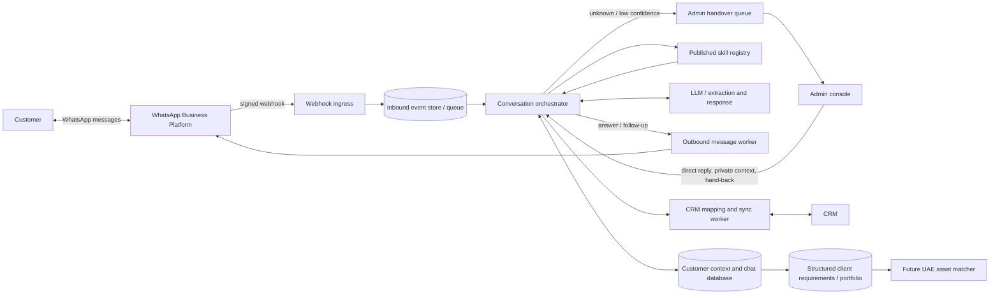

# WhatsApp Real Estate Agent — Architecture Proposal

**Status:** For architecture review  
**Scope:** WhatsApp automation, CRM synchronization, and customer context mapping. Email is excluded.  
**Future extension:** Match structured client requirements against UAE property assets. Inventory ingestion and matchmaking are later phases; this phase prepares compatible data and APIs without claiming to search live inventory.

## 1. Product model

A customer starts or continues a WhatsApp conversation. A conversational agent uses the currently published set of skills to understand the customer's goal, ask relevant follow-up questions, and maintain a structured client context. The customer can be a buyer, seller, or both. The system stores the full chat history and maps facts from that history into CRM and customer context records.

Skills are versioned instruction/configuration bundles (for example, `buyer_intake`, `seller_intake`, `portfolio_capture`, and `general_uae_property_faq`). They guide what to ask and how to handle a domain. Conversation transcripts are retained as evidence and as material for an admin to review when proposing new or improved skills. Chats must not automatically rewrite or publish skills: an admin reviews, tests, versions, and publishes changes. This keeps learning auditable and prevents one customer's conversation from silently changing behavior for everyone.

When the agent cannot answer confidently, encounters an unknown question, or needs an admin decision, it pauses automated replies and creates a handover. An admin can send a direct WhatsApp reply, provide private context for the assistant to use, or do both. The system records which action happened. The assistant resumes only after an explicit admin hand-back. Private admin context is not sent to the customer unless the admin deliberately turns it into a reply.

## 2. Visible architecture diagram



`CDB` represents the structured context tables in the application database, not a separate database. The future matcher is shown as a downstream consumer only; inventory and matching are not part of the current WhatsApp delivery scope.

## 3. WhatsApp conversation flow

1. **Receive:** Customer messages the WhatsApp business number. The provider webhook is signature-checked, normalized, deduplicated, and persisted before acknowledging receipt.
2. **Identify:** Resolve the contact by WhatsApp number and provider account. Create a contact/conversation when needed. Link a CRM record if a stable match exists; otherwise create a CRM lead according to the agreed CRM mapping policy.
3. **Understand intent:** Classify the conversation as buying, selling, portfolio sharing, general enquiry, or unclear. Load relevant customer context and the published skill version selected for the turn.
4. **Extract and ask:** Store the inbound message, extract candidate facts with source and confidence, update structured context, and ask the most useful missing or clarifying question. Do not repeat fields already answered unless clarification is needed.
5. **Synchronize:** Queue CRM create/update events for meaningful contact, intent, requirement, portfolio, and consent changes. CRM failure must not discard the message or conversation update.
6. **Answer or hand over:** If the question is in-skill and sufficiently supported, respond. If unknown, low-confidence, sensitive, contradictory, or explicitly requested for a human, create a handover and pause assistant sends.
7. **Admin action:** Admin reviews recent messages, structured context, selected skill/version, and handover reason. Admin may send a direct reply, add private context/instructions for this conversation, or both. Every action is attributed and stored.
8. **Resume:** Admin explicitly hands back to the assistant. The orchestrator incorporates approved private context into the next turn, resumes the applicable skill, and continues collecting missing information.
9. **Future matching readiness:** When requirements are sufficiently structured, mark the requirement as ready for later matching. No asset recommendation is made in this phase.

### Example buy/sell coverage

For a buyer, the agent progressively captures property type, desired location(s), budget and currency, timing, purpose (own use/investment/other), bedrooms/size and other preferences the customer shares. For a seller, it captures the property or properties, location, type, size/bedrooms, ownership/availability details, expected price and currency, sale timing, and purpose or constraints. The customer may also share an existing real estate portfolio, which is stored separately from what they are looking to buy or sell. The schema permits multiple requirements and multiple portfolio assets per client.

## 4. System components

| Component | Responsibility |
| --- | --- |
| WhatsApp adapter | Provider-specific webhook verification, payload normalization, outbound sends, template/session enforcement, and delivery callbacks. |
| Webhook ingress | Fast validation and durable event acceptance; deduplication and queue handoff. |
| Conversation orchestrator | State machine; contact resolution; skill selection; context loading; extraction, response, handover, and CRM event decisions. |
| Skill registry | Draft, tested, published, and retired skill versions with scope, prompts/instructions, required fields, escalation rules, and change history. |
| Extraction/response service | Converts messages to candidate structured facts and generates constrained responses using only permitted context and skill instructions. |
| Admin console/API | Review chat and context, manage handover, reply directly, add private conversation context, correct facts, and review/publish skill versions. |
| Context database | Contacts, conversations, immutable message history, facts, current requirements, portfolio, skill usage, handovers, and audit records. |
| CRM adapter/worker | Idempotent mapping and synchronization with the chosen CRM; retry, reconciliation, and visible failure state. |
| Queue/outbox | Durable asynchronous inbound processing and outbound/CRM side effects with bounded retries and dead-letter handling. |
| Future inventory/matching service | Later consumer of structured requirements and asset data; not implemented in this phase. |

## 5. Conversation states and rules

Suggested states: `active_agent`, `admin_handover`, `admin_owned`, `awaiting_admin_handback`, `ready_for_matching`, and `closed`. `active_agent` means automated agent is permitted to respond. The state is on the conversation; a separate handover record captures each escalation. `ready_for_matching` is a qualification marker and need not stop conversation activity, so it may be better represented as a profile status rather than a mutually exclusive conversation state.

Rules:

- While a handover is open or an admin owns the conversation, automated customer-facing messages are blocked.
- Admin direct replies are sent through the same outbound worker and stored as messages with `sender_type=admin`.
- Private context is stored separately from chat messages and is never rendered as customer-visible text. It may be supplied to the agent for this conversation after authorization.
- Hand-back is explicit and audited. Silence, elapsed time, or a successful admin reply does not resume automation by itself.
- Every generated response references the skill version and context/facts used, for review and troubleshooting.
- Facts are not silently overwritten by lower-confidence or contradictory extraction. Retain provenance and flag conflicts for clarification or admin review.
- Skill content is shared configuration. Only authorized admins can publish a new version; conversations may record the version used for each turn.

## 6. Customer context and schema

Use a relational database such as PostgreSQL. UUID identifiers and UTC timestamps are assumed. Keep raw conversations as message records and structured context as queryable records; do not make an LLM summary the only copy of customer facts.

### `contacts`

One person/client identity, potentially linked to multiple conversations and CRM records.

| Fields | Description |
| --- | --- |
| `id UUID PK` | Internal identity. |
| `phone_e164 TEXT UNIQUE` | WhatsApp number; consider provider/account scoping if multiple business tenants exist. |
| `display_name TEXT NULL` | Name as supplied by customer/provider. |
| `preferred_language TEXT NULL` | Language preference when known. |
| `consent_status TEXT` | Consent/opt-out state according to the approved policy. |
| `created_at`, `updated_at TIMESTAMPTZ` | Lifecycle timestamps. |

### `conversations`

| Fields | Description |
| --- | --- |
| `id UUID PK`, `contact_id UUID FK` | Conversation and client. |
| `channel TEXT` | `whatsapp` in this scope. |
| `provider_account_id TEXT`, `provider_thread_id TEXT NULL` | Provider routing and thread identifiers. |
| `state TEXT` | Current automation/admin state. |
| `active_intent TEXT NULL` | `buy`, `sell`, `portfolio`, `general`, `unknown`, or `mixed`. |
| `assigned_admin_id UUID/TEXT NULL` | Current admin owner. |
| `last_inbound_at`, `last_outbound_at TIMESTAMPTZ NULL` | Activity. |
| `created_at`, `updated_at`, `closed_at TIMESTAMPTZ NULL` | Lifecycle. |

Indexes: `(contact_id, updated_at DESC)`, `(state, updated_at)`, unique provider event/thread keys as applicable.

### `messages`

Append-only record of all inbound and outbound chat messages. Admin private context does not belong in this table.

| Fields | Description |
| --- | --- |
| `id UUID PK`, `conversation_id UUID FK` | Message and conversation. |
| `provider_message_id TEXT NULL` | Unique provider message key for deduplication, scoped by provider/account. |
| `direction TEXT` | `inbound` / `outbound`. |
| `sender_type TEXT` | `customer`, `agent`, `admin`, or `system`. |
| `body_text TEXT NULL`, `message_type TEXT` | Text and normalized type; media can be added via attachments later. |
| `provider_timestamp TIMESTAMPTZ NULL` | Provider event time. |
| `delivery_status TEXT NULL` | `queued`, `sent`, `delivered`, `read`, `failed`, etc. |
| `skill_version_id UUID NULL` | Skill version used for an automated response. |
| `created_at TIMESTAMPTZ` | Ingestion/creation time. |

### `client_context`

Small set of cross-conversation client context fields, with changes also traceable in `context_facts`.

| Fields | Description |
| --- | --- |
| `id UUID PK`, `contact_id UUID FK UNIQUE` | One current context root per client. |
| `purpose_notes TEXT NULL` | Customer-stated purpose/general context. |
| `other_shared_context JSONB` | Flexible typed extensions for customer-shared information not yet promoted to a first-class field. |
| `updated_at TIMESTAMPTZ` | Last update. |

### `property_requirements`

One client can have multiple active or historical buy/sell requirements. This is the primary future matchmaking input.

| Fields | Description |
| --- | --- |
| `id UUID PK`, `contact_id UUID FK` | Requirement and client. |
| `conversation_id UUID FK NULL` | Conversation source. |
| `transaction_type TEXT` | `buy` or `sell`. |
| `property_type TEXT NULL` | Apartment, villa, townhouse, land, etc.; controlled vocabulary can evolve. |
| `locations JSONB NOT NULL DEFAULT []` | UAE emirate/community/place IDs and customer phrasing. |
| `budget_min NUMERIC(16,2) NULL`, `budget_max NUMERIC(16,2) NULL` | Buy budget or expected sale price range. |
| `currency CHAR(3) NULL` | ISO 4217 currency. |
| `bedrooms_min SMALLINT NULL`, `bedrooms_max SMALLINT NULL` | Optional range. |
| `size_min NUMERIC(14,2) NULL`, `size_max NUMERIC(14,2) NULL`, `size_unit TEXT NULL` | Optional area and unit. |
| `timing_from DATE NULL`, `timing_to DATE NULL`, `timing_text TEXT NULL` | Structured and original timing. |
| `purpose TEXT NULL` | Own use, investment, sale, etc., in customer terms/controlled tags. |
| `preferences JSONB NOT NULL DEFAULT {}` | Other typed criteria such as furnishing, view, payment plan. |
| `notes TEXT NULL` | Additional customer-shared requirement details. |
| `status TEXT` | `active`, `paused`, `fulfilled`, `withdrawn`, `superseded`. |
| `match_readiness TEXT` | `incomplete`, `ready`, `needs_review`; no match results implied. |
| `created_at`, `updated_at TIMESTAMPTZ` | Lifecycle. |

### `portfolio_assets`

Customer's current real estate portfolio, distinct from their desired purchase/sale criteria. Supports multiple properties and uncertain/partial details.

| Fields | Description |
| --- | --- |
| `id UUID PK`, `contact_id UUID FK` | Portfolio item and client. |
| `property_type TEXT NULL`, `location JSONB NULL` | Known asset description. |
| `ownership_status TEXT NULL` | Owned, co-owned, under contract, rented, etc., when shared. |
| `bedrooms SMALLINT NULL`, `size NUMERIC(14,2) NULL`, `size_unit TEXT NULL` | Optional facts. |
| `estimated_value NUMERIC(16,2) NULL`, `value_currency CHAR(3) NULL` | Only if supplied or clearly attributed estimate. |
| `acquisition_date DATE NULL`, `portfolio_notes TEXT NULL` | Optional information. |
| `status TEXT` | `current`, `sold`, `unknown`. |
| `created_at`, `updated_at TIMESTAMPTZ` | Lifecycle. |

### `context_facts`

Provenance and history for structured field values, including requirements, portfolio, and client context.

Fields: `id UUID PK`, `contact_id UUID FK`, `entity_type TEXT`, `entity_id UUID`, `field_key TEXT`, `value_json JSONB`, `confidence NUMERIC(4,3) NULL`, `source_type TEXT` (`customer_message`, `admin`, `agent_extraction`), `source_message_id UUID NULL`, `created_by TEXT NULL`, `valid_from TIMESTAMPTZ`, `superseded_at TIMESTAMPTZ NULL`, `created_at TIMESTAMPTZ`. Keep customer statements distinguishable from inferred facts and admin corrections.

### `skills` and `skill_versions`

`skills`: `id`, `key UNIQUE`, `name`, `description`, `status`, `created_at`, `updated_at`.  
`skill_versions`: `id`, `skill_id`, `version`, `instructions`, `required_fields JSONB`, `triggers JSONB`, `escalation_rules JSONB`, `status` (`draft`, `testing`, `published`, `retired`), `created_by`, `approved_by`, `published_at`, `created_at`. Unique `(skill_id, version)`. Published versions are immutable; edits create a new version.

### `handover_cases`

Fields: `id`, `conversation_id`, `status` (`open`, `admin_owned`, `resolved`, `handed_back`), `reason_code`, `reason_summary`, `trigger_message_id`, `assigned_admin_id`, `opened_at`, `resolved_at`, `handback_at`. One open handover per conversation, enforced transactionally.

### `admin_context_notes`

Private conversation-scoped instructions/context. Fields: `id`, `conversation_id`, `handover_case_id`, `admin_id`, `note_text`, `visibility` (always `internal` in this phase), `created_at`, `superseded_at`. These notes are available to the assistant only in that conversation after authorization; never sent as customer messages.

### `crm_links`, `integration_events`, and `audit_events`

- `crm_links`: internal contact/requirement IDs, CRM name, external contact/lead IDs, mapping status, last sync/error, timestamps. Use unique constraints on external IDs and internal-to-CRM mappings.
- `integration_events`: inbox/outbox event ID, integration, external event ID, event type, aggregate ID, payload, status, attempt count, next retry, error, timestamps. Unique inbound key `(integration, external_event_id)`.
- `audit_events`: actor, action, entity, before/after state references, reason, metadata, timestamp. Capture admin replies, private context additions, fact corrections, skill publication, handover transitions, and CRM mapping changes.

## 7. Skill lifecycle and controlled learning

1. Persist every chat message according to retention policy and link automated turns to skill versions.
2. Admins review unresolved questions, corrections, repeated follow-ups, and useful conversation patterns. A future reporting view can group these without exposing more personal information than needed.
3. Admin drafts or edits a skill with its purpose, trigger conditions, instructions, required fields, examples, and escalation rules.
4. Run offline scenarios/redacted transcript cases against the draft and review outputs. A second-person approval can be added if governance requires it.
5. Publish a new immutable version. New turns use it according to routing rules; in-progress conversations can remain pinned to their prior version or upgrade explicitly.
6. Monitor handover rate, missing-field completion, corrections, and response quality; retire or roll back a version if it performs poorly.

Chats are learning evidence; they are not themselves trusted instructions. Customer content must never be executed as a skill or allowed to override system/admin policy.

## 8. API outline

Internal APIs use HTTPS, authenticated roles, authorization checks, request IDs, and idempotency keys for mutations. Exact routes can be adjusted after the admin interface and CRM are selected.

### WhatsApp provider callbacks

| Method / route | Purpose |
| --- | --- |
| `GET /webhooks/whatsapp` | Provider challenge verification when required. |
| `POST /webhooks/whatsapp` | Verify signature, deduplicate and persist inbound message/status event, enqueue, acknowledge quickly. |

### Conversation and context APIs

| Method / route | Purpose |
| --- | --- |
| `GET /api/conversations?state=admin_handover` | Admin queue and filters. |
| `GET /api/conversations/{id}` | Messages, current context, active requirements, portfolio, skill/version, CRM sync and handover state. |
| `GET /api/contacts/{id}/context` | Client context, requirements, portfolio, provenance, CRM link. |
| `POST /api/conversations/{id}/messages` | Admin sends a direct WhatsApp reply; persist and send through outbound worker. |
| `POST /api/conversations/{id}/handovers` | Create/assign handover, pause automation, record reason. Normally orchestrator initiated; admin API can create manually. |
| `POST /api/handovers/{id}/context-notes` | Add private context for this conversation. Never sends a customer message. |
| `POST /api/handovers/{id}/handback` | Explicitly return conversation to automation, optionally with admin summary. |
| `PATCH /api/contacts/{id}/context` | Admin correction to general context with provenance. |
| `POST /api/contacts/{id}/requirements` | Create a buy/sell requirement. |
| `PATCH /api/requirements/{id}` | Correct/update requirement fields and readiness. |
| `POST /api/contacts/{id}/portfolio-assets` | Add a customer-shared current property. |
| `PATCH /api/portfolio-assets/{id}` | Correct portfolio details/status. |

### Skill administration APIs

| Method / route | Purpose |
| --- | --- |
| `GET /api/skills` | List skill keys, active versions, and status. |
| `POST /api/skills` | Create a skill definition (admin role). |
| `POST /api/skills/{id}/versions` | Create a draft version; existing published versions remain immutable. |
| `POST /api/skill-versions/{id}/test` | Run approved test scenarios and return results. |
| `POST /api/skill-versions/{id}/publish` | Publish a reviewed version (admin authorization and audit). |
| `POST /api/skill-versions/{id}/retire` | Retire a version and route to a replacement or safe fallback. |

### CRM and operational APIs

| Method / route | Purpose |
| --- | --- |
| `GET /api/contacts/{id}/crm-status` | Show CRM mapping and last sync result. |
| `POST /api/operations/crm-sync/{contact_id}/retry` | Authorized retry for a failed sync. |
| `POST /api/operations/conversations/{id}/resume` | Admin-only recovery action after checking paused/error state; audited. |

### Example structured context response

```json
{
  "contact_id": "uuid",
  "requirements": [{
    "transaction_type": "buy",
    "property_type": "villa",
    "locations": [{"label": "Dubai", "emirate": "Dubai"}],
    "budget_min": null,
    "budget_max": 4000000,
    "currency": "AED",
    "timing_text": "within six months",
    "purpose": "investment",
    "match_readiness": "incomplete"
  }],
  "portfolio_assets": [],
  "last_updated_at": "2026-11-24T10:00:00Z"
}
```

## 9. CRM synchronization and customer context mapping

The application database is authoritative for message history, provenance, workflow, skill version, and structured context. The CRM is the sales team's operational record. The CRM adapter maps contacts and agreed requirement fields to CRM objects/fields, stores external IDs, and uses upserts to prevent duplicate leads.

Before implementation, decide whether a buy requirement and sell mandate map to separate CRM leads/opportunities or one client record with related opportunities. Do not flatten multiple simultaneous requirements or portfolio holdings into a single free-text CRM note if structured custom fields/objects are available. Preserve source and timestamp for mapped values, define conflict rules for CRM edits, and avoid overwriting a verified human-entered value with a low-confidence extraction. CRM sync is asynchronous, retryable, observable, and does not block WhatsApp handling.

## 10. Future UAE inventory and matchmaking contract

Current phase stores requirements in a normalized shape that a later asset catalogue can match. Before matching begins, inventory needs its own source, refresh policy, licensing/permissions, identifiers, and normalized schema. The later matcher can consume `property_requirements` and compare transaction type, location, property type, budget/currency, bedrooms/area, timing, and preferences against assets. It should return match candidates with reasons and data freshness; an agent should review results before customer delivery until product policy explicitly allows automation. No inventory tables are specified as current-phase requirements.

## 11. Reliability, security, and privacy

- Verify provider webhook signatures and use provider message/event IDs for idempotency.
- Persist inbound events and state changes before acknowledging or triggering external side effects; dispatch sends/CRM writes through an outbox.
- Preserve per-conversation ordering where possible and guard state transitions against races.
- Block AI outbound sends transactionally when a handover/admin ownership is active.
- Use bounded retries and dead-letter queues; show failures to admins with safe retry controls.
- Encrypt data in transit and at rest; use role-based access for admin, agent, and service identities; keep secrets in a managed secret store.
- Define customer consent, opt-out, access, deletion, and retention policies before launch. Chat retention must be long enough for the stated learning/review purpose and bounded by policy.
- Restrict private admin context to the relevant conversation and authorized service calls. Record access and changes.
- Minimize model context to relevant messages and facts. Treat chats as untrusted input; do not let them change skills, policies, tools, or permissions.
- Keep logs focused on IDs, state, timings, and error codes; avoid logging full message bodies, admin notes, tokens, or unnecessary personal data.

Confirm current WhatsApp provider rules for customer service windows, templates, opt-in, rate limits, and delivery callbacks when selecting the integration. The adapter must enforce applicable sending restrictions and present actionable failures to admins.

## 12. Delivery sequence

1. Confirm CRM, WhatsApp provider/business number, admin interface, buy/sell fields, language/currency needs, and privacy policy.
2. Review schema, CRM mapping, skill governance, handover triggers, and state transitions.
3. Implement webhook ingestion, message persistence, contact/conversation resolution, admin inbox, direct replies, pause, and hand-back.
4. Add structured extraction for buyer/seller requirements, portfolio, and general context with provenance and admin corrections.
5. Add skill registry/version lifecycle and controlled draft-test-publish flow.
6. Add CRM synchronization, retries, and reconciliation.
7. Pilot with human review enabled; monitor errors, handovers, corrections, completeness, and customer experience.
8. In a separate phase, ingest UAE assets and build/review matchmaking.

## 13. Decisions for review

1. Which CRM and WhatsApp provider/business number are selected?
2. Which roles are included under “admin,” and is the agent persona an automated assistant, human agent, or both? This proposal treats “agent” as the automated conversational agent and “admin” as the human operator.
3. Which skills are needed at launch (buyer intake, seller intake, portfolio capture, FAQs)?
4. What exactly triggers handover: unknown topic, low confidence threshold, customer request, contradictions, sensitive question, or all of these?
5. Can admin context be applied to one turn or persist for the conversation, and when should it expire?
6. Should an admin reply leave automation paused until explicit hand-back in every case? Proposed default: yes.
7. What is the minimum completeness definition for a requirement to be ready for future matching?
8. Which UAE location taxonomy, currencies, languages, and property types should be standardized first?
9. What consent, retention, and deletion policies apply to chat-based skill review and customer context?

## 14. Architecture review checklist

- WhatsApp messages are stored once despite webhook retries and remain linked to client context.
- Buy requirements, sell requirements, current portfolio, and other shared context are distinct structured data.
- Every structured fact has provenance and can be corrected without losing history.
- A handover pauses automation; admin can reply or add private context; explicit hand-back resumes it.
- Skill changes are reviewed, versioned, tested, and attributable; raw chats do not self-publish instructions.
- CRM create/update behavior is idempotent, mapped, retryable, and visible to admins.
- Structured requirements are suitable for a future UAE asset matcher without implying inventory availability today.
