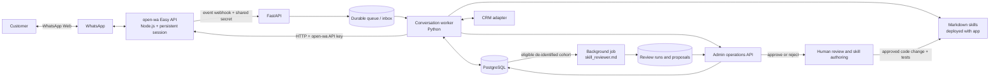

# WhatsApp Real Estate Agent — Step-by-Step Implementation Guide

**Status:** Proposed sequence for review; no implementation code is included here.  
**Application stack:** Python managed with `uv`, FastAPI, and a relational database.  
**WhatsApp connection:** open-wa Easy API, run as a separate Node.js service.  
**Scope:** WhatsApp conversations, structured customer context, admin handover, CRM synchronization, and controlled skill development. UAE inventory and matching remain a later phase.

This guide turns the architecture proposal in [`ARCHITECTURE.md`](ARCHITECTURE.md) into reviewable implementation stages. Complete the stage gates before moving to the next stage so CRM and WhatsApp-specific assumptions are settled before they become code.

## 1. Runtime topology



The Python service owns product behavior, persistence, skills, CRM mapping, and admin workflows. open-wa owns the WhatsApp Web session and exposes HTTP operations. Keep the open-wa Easy API and health endpoint reachable only from the application/private network; never expose its API key publicly. The Easy API supports control over HTTP from languages other than Node.js and supports webhook delivery of events to a backend. [open-wa Easy API](https://openwa.dev/docs/getting-started/easy-api), [open-wa receive messages](https://openwa.dev/docs/guides/receive-messages)

## 2. Decisions and prerequisites

Before implementation begins, record decisions for:

- CRM product, authentication method, object model, custom fields, and conflict rules.
- WhatsApp number/device that will be linked, who owns the device, and how session recovery will work.
- Initial deployment is one business account/session; record this as a scope boundary and keep provider session IDs in stored mappings.
- open-wa deployment model, version pinning, license tier, and accepted operational/account risk.
- Admin identity provider/authentication and API client authorization. Use the CRM only if its conversation ownership and handover controls meet the requirements.
- Initial Markdown skills, language(s), currencies, UAE location vocabulary, and requirement completeness criteria.
- Retention/deletion policy for message history, customer context, raw event payloads, and transcript exports.
- Hosting, database, queue, secrets manager, backups, monitoring, and deployment environments.

### open-wa validation gate

open-wa is a Node.js toolkit operating through WhatsApp Web, not the official WhatsApp Business Platform API. Its documentation describes the project as unofficial and not affiliated with Meta/WhatsApp. Before production, explicitly review the current open-wa terms, operational reliability, linked-device limits, session persistence, and the business's tolerance for account/service disruption. [open-wa project](https://github.com/open-wa/wa-automate-nodejs)

Pin an open-wa release rather than using an unversioned `latest` deployment. Current documentation lists Node.js 22.21.1 or newer for the Easy API quick start; use the version required by the pinned release. [open-wa quick start](https://openwa.dev/docs/getting-started/quickstart)

Interactive messages (buttons, lists, forms, and other formats) require an applicable open-wa license. Confirm the exact license entitlement and exercise it in a test account before designing the launch intake around interactive messaging. Keep free-text alternatives available. [open-wa licensed features](https://openwa.dev/docs/licensing/licensed-features), [open-wa interactive messages](https://openwa.dev/docs/guides/interactive-messages)

## 3. Suggested repository layout

```text
.
├── pyproject.toml                 # Python package/dependencies managed by uv
├── uv.lock                        # Reproducible Python dependency lock
├── app/
│   ├── api/                        # FastAPI routes and request/response models
│   ├── config/                     # Settings and environment parsing
│   ├── db/                         # Models, migrations, repositories
│   ├── integrations/
│   │   ├── openwa/                 # Event normalization and HTTP client
│   │   └── crm/                    # CRM adapter and field mapping
│   ├── conversations/              # State machine, orchestration, extraction
│   ├── skills/                     # Markdown loader and skill selection
│   ├── workers/                    # Queue consumers and outbox dispatchers
│   └── admin/                      # Admin services and authorization
├── skills/
│   ├── buyer_intake.md
│   ├── seller_intake.md
│   ├── portfolio_capture.md
│   ├── general_property_questions.md
│   └── skill_reviewer.md            # Offline transcript review and proposal drafting only
├── migrations/
├── tests/
├── deploy/
│   └── openwa/                     # Pinned Easy API config/container/deployment
└── docs/
```

The open-wa Easy API may be run from its generated Node.js project or deployment image rather than added as a Python dependency. Keep its deployment/configuration in the repository or infrastructure repository, with secrets supplied by the runtime environment.

## 4. Implementation stages

### Stage 0 — Integration and product decisions

1. Confirm the open-wa number/session and test-device ownership.
2. Verify session persistence/recovery on the intended host and container restart behavior.
3. Confirm license availability for interactive message types intended for launch.
4. Confirm CRM API access in a sandbox and document field/object mappings.
5. Approve the initial customer context schema, handover reasons, privacy/retention rules, and skill list.

**Exit gate:** written decisions for all prerequisites; successful manual QR pairing and reconnect on a non-production test number; interactive feature/license decision documented.

### Stage 1 — Python service and deployment foundation

1. Create the Python project and dependency lock with `uv`; define settings through typed environment configuration.
2. Add FastAPI application startup/liveness/readiness behavior and structured request logging.
3. Provision PostgreSQL and migrations; establish separate development, staging, and production configurations.
4. Provision secrets for database access, open-wa API key, open-wa webhook shared secret, CRM credentials, and model provider.
5. Select and provision a durable queue or implement a database-backed inbox/outbox for the first deployment. Ensure workers can retry after restart.
6. Add application release/commit metadata so each automated message can record the deployed release.

**Exit gate:** service starts in each environment; migrations run reliably; secrets are not stored in source control; backup/restore approach is documented.

### Stage 2 — open-wa service and transport adapter

1. Deploy a pinned open-wa Easy API in a private network, with its HTTP listener bound to localhost/private interface.
2. Configure `WA_API_KEY`, persistent session storage, and the selected `sessionId` through deployment secrets/config.
3. Link a test WhatsApp account by QR scan and verify that restart restores the linked session without exposing public pairing or session-control endpoints.
4. Configure the open-wa webhook integration to send only required events (at minimum inbound messages and message acknowledgement/status changes) to FastAPI over HTTPS/private networking.
5. Configure a high-entropy shared secret header for webhook requests. The integration's documented webhook delivery uses configured headers and retries; it is not inherently a signed Meta webhook, so validate the shared secret and network boundary at FastAPI.
6. Implement the open-wa HTTP client in Python. Attach the API key to every call, use timeouts, and do not log credentials or full customer messages.
7. Normalize open-wa event envelopes into internal events without passing provider-specific fields into conversation logic.

**Suggested normalized event types:** `message.inbound`, `message.acknowledged`, `session.status_changed`, and `message.send_failed`.

**Exit gate:** incoming text reaches a local/staging FastAPI webhook once; outbound test text succeeds through FastAPI → open-wa → WhatsApp; auth failures are rejected; API is unreachable from public internet.

### Stage 3 — Durable messaging and conversation history

1. Implement inbound event verification, validation, deduplication, and persistence before returning a success response to open-wa.
2. Use provider event/message IDs plus session/account identity as idempotency keys. Handle the case where the database commit succeeds but the webhook response is lost and open-wa retries.
3. Add contacts, conversations, messages, and audit migrations from the architecture proposal.
4. Persist every customer-visible message: inbound customer messages, automated replies, and every admin reply after handover. Store sender, direction, provider IDs, timestamps, delivery/ack status, and interactive payloads when present.
5. Track incoming message order and original interactive message IDs so a selected option can be matched to the question that produced it.
6. Build conversation history retrieval with pagination and authorization.
7. Add a durable outbox before any outbound send. Record the intent first; a worker performs the open-wa call and stores the result.

**Exit gate:** duplicate webhooks create no duplicate messages; all message actors appear in the thread; failed sends are visible and retryable without losing the original intent.

### Stage 4 — Admin APIs and handover

1. Add admin authentication and role-based authorization.
2. Implement authenticated query APIs for open/assigned `handover_cases`, including reason, latest message, contact context, CRM sync status, and paginated transcript.
3. Add assignment, takeover, direct text reply, private context note, and explicit hand-back actions.
4. Persist admin replies as normal outbound messages with `sender_type=admin`, actor identity, open-wa message ID, and acknowledgement/delivery status history.
5. Keep internal context notes in their separate table; never expose them in the WhatsApp transcript or outbound payload accidentally.
6. Enforce a concurrency-safe pause: no assistant send may pass the final state check once a handover/admin ownership is active.
7. Require an explicit admin hand-back before AI resumes; record who handed back, when, and any summary.

**Exit gate:** an unknown-question handover pauses automation; admin can reply; message appears in chat history; assistant remains paused until explicit hand-back.

### Stage 5 — Customer context and CRM synchronization

1. Implement structured context records for client purpose/other shared context, multiple buy/sell requirements, and multiple current portfolio assets.
2. Extract facts with provenance: source message, customer-stated vs inferred vs admin-corrected, confidence, timestamp, and supersession history.
3. Ask clarifying questions when values conflict, currency is unclear, or extraction confidence is below the agreed threshold.
4. Implement CRM identity/link mapping and idempotent create/update operations behind a CRM adapter.
5. Choose how multiple buy/sell requirements map to CRM opportunities/leads; do not flatten portfolio and requirements into an unstructured note if the CRM can represent them separately.
6. Persist CRM sync work to the outbox. Expose sync status, last error, and retry action to admins.
7. Ensure CRM outages do not block conversation storage or cause duplicate CRM records after retries.

**Exit gate:** a test conversation creates/links one CRM person and updates one or more mapped requirement records idempotently; failed CRM calls are visible and recoverable.

### Stage 6 — Markdown skills and controlled chat-based learning

1. Add the skill loader and a stable file/key convention. Skills remain Markdown files in version control, deployed with the Python application.
2. Define launch skills for buyer intake, seller intake, portfolio capture, and general property questions; each should state intent, required/optional fields, interaction style, fallback wording, and handover triggers.
3. Log `skill_key` and application release/commit on each automated response.
4. Add an audited transcript export path that can select all conversations or a cohort/date range and includes customer, automated-agent, and admin-sent messages.
5. Default skill-review exports to de-identified copies. Exclude private admin notes, secrets, and unrelated personal information; retain exports only as long as needed.
6. Human reviewers identify useful patterns in successful admin answers, repeated unknown questions, and effective follow-up sequences. A developer authors a new/updated `.md` skill from reviewed patterns.
7. Review the skill change, test it against representative redacted conversations and edge cases, commit it, and deploy it. No raw chat directly rewrites production skill files.
8. Add a separately scheduled/manual review worker using `skill_reviewer.md`. It reads only approved de-identified transcript cohorts, identifies recurring issues above a configurable minimum evidence threshold, and stores a proposal containing the issue, sanitized evidence references, proposed diff, and regression tests.
9. Add authenticated proposal query/decision APIs. A supervisor may approve or reject with a reason. Approval queues a human-authored code change; it does not edit Markdown files, merge a branch, or deploy. The resulting change still requires code review, CI, and deployment.

**Exit gate:** a reviewer can trace an automated reply to its skill and release; a full/filtered transcript export contains admin replies and excludes internal notes; a new skill becomes active only after deployment.

**Skill-review exit gate:** a scheduled run over a de-identified test cohort produces a proposal and regression tests; a single anecdote below the configured threshold is not generalized; the reviewer cannot change live skills; proposal approval/rejection is attributable and does not deploy.

### Stage 7 — WhatsApp interactive choices

1. Confirm open-wa license entitlement for interactive messages before implementation; the feature is documented as license-gated.
2. Define stable choice IDs in the relevant Markdown skills (for example, `buy`, `sell`, `both`) and keep display labels separate.
3. Implement a provider adapter mapping skill option definitions to open-wa's supported interactive message document.
4. Store the sent interactive payload and returned message ID in `messages`.
5. Normalize selection callbacks as inbound message/event records; persist selected option ID, label, and originating message ID.
6. Accept typed free-text answers even when a list or button was offered.
7. Fall back to a text question if the license, recipient, session, or provider does not support the desired interactive message.
8. Consider larger multi-field forms only after testing supported open-wa interactive types and the UX with real devices.

**Exit gate:** test recipients can select a button/list choice and the chosen stable ID updates the correct profile field; a free-text answer and fallback path also work.

### Stage 8 — Assistant orchestration and guardrails

1. Select the LLM/provider and implement a narrow extraction contract for intent, candidate facts, confidence, missing fields, and escalation reason.
2. Load only relevant recent messages, structured context, applicable skill, and conversation-scoped admin context. Never treat customer transcript text as trusted instructions.
3. Add response policy: only answer from approved skill/context; no invented inventory, price, legal/financial, or availability claims; unknown or sensitive questions trigger handover.
4. Before send, re-check conversation ownership and opt-out state transactionally. Cancel queued AI sends if admin takeover happened after generation or the customer opted out. Define the approved exception, if any, for human replies after opt-out.
5. Save the generated response, skill/release, and relevant decision metadata before sending through the outbox.
6. Add rate limits, token/cost limits, timeout handling, and a safe fallback when model/extraction calls fail.
7. Add rollout modes: `off`, `shadow`, `assisted`, `canary`, and `active`. Start production in `shadow`; require a supervisor reason to change mode. Add a global kill switch that blocks AI sends while preserving inbound capture and admin operations. Canary mode must use an explicit expiring allowlist, never model/customer-selected eligibility.

**Exit gate:** tested unknown, conflicting, maliciously phrased, and unsupported requests hand over; paused conversations never receive AI sends; extracted facts keep provenance; shadow and kill-switch modes cannot send to customers.

### Stage 9 — Observability, recovery, and pilot

1. Track webhook counts/latency, duplicate events, queue age, open-wa session health, send failures, admin handover backlog, CRM sync lag, extraction errors, and interactive selection/fallback rates.
2. Alert on session disconnects, stuck queues, repeated open-wa failures, CRM failure spikes, and missed event delivery.
3. Test open-wa restart, network loss, expired session, event retry/duplicate, and recovery without losing messages.
4. Test database/queue restoration and CRM reconciliation.
5. Run a controlled pilot with human review readily available; inspect transcripts and data quality before increasing automation.
6. Use pilot outcomes to refine skills through the reviewed Markdown/deployment loop.

**Exit gate:** recovery procedures work in staging; an admin can see and resolve failed sends/syncs; pilot approval is based on measurable quality and operational results.

## 5. Recommended MVP boundary

For the first usable release, prioritize:

1. open-wa connectivity and text messages.
2. Durable conversation history, including admin replies.
3. Admin APIs for handover queue, direct replies, takeover, and hand-back.
4. Buyer/seller requirements and portfolio capture with provenance.
5. CRM create/update with retries.
6. A small set of Markdown skills and controlled transcript export.
7. Interactive lists/buttons only after the open-wa license and device behavior are confirmed.

Defer asset inventory, automated property matching, customer-facing recommendations, broad campaign messaging, and self-updating skills.

## 6. Key implementation risks and mitigations

| Risk | Mitigation |
| --- | --- |
| open-wa session disconnect or loss | Persistent session storage, health monitoring, documented QR re-link procedure, and tested restart/recovery. |
| Webhook events duplicated or lost during restart | Idempotent database inbox, open-wa webhook durability where configured, dead-letter monitoring, and reconciliation procedures. open-wa docs note the webhook queue is in-memory by default unless durability is enabled. |
| open-wa interactive features unavailable | Verify license and message support early; maintain a text fallback. |
| Admin takes over while AI response is queued | Re-check ownership/state immediately before send and cancel AI outbox item after takeover. |
| Chats expose personal information during skill review | Restrict exports, de-identify copies by default, omit private notes, set retention, and use redacted examples in code review. |
| CRM fields conflict with extracted facts | Preserve provenance and source priority; surface conflicts for human resolution. |
| Skill overfits to one customer conversation | Review patterns across cases, generalize examples, test edge cases, deploy only reviewed changes. |

## 7. Suggested initial skills

- `buyer_intake.md`: intent, budget/currency, property type, locations, timing, purpose, bedrooms/area, preferences.
- `seller_intake.md`: asset/location/type, size/bedrooms, ownership/availability, expected price/currency, sale timing, constraints.
- `portfolio_capture.md`: current properties and customer-shared ownership/portfolio details.
- `general_property_questions.md`: approved general answers and explicit handover boundaries.
- `unknown_question_handover.md`: acknowledge unknowns, avoid guessing, create admin handover, and resume after admin hand-back.
- `skill_reviewer.md`: offline-only reviewer prompt that spots repeated mistakes in de-identified chats and drafts proposed skill diffs plus regression tests. It cannot answer customers or directly edit/deploy skills.

Each skill should use stable field/option IDs, distinguish required from optional information, specify interactive choices where useful, and define free-text and handover behavior.

## 8. Items to settle in architecture review

1. Is open-wa's unofficial WhatsApp Web integration risk acceptable for this business and intended scale?
2. Which exact open-wa license tier is available, and are interactive messages included?
3. Where will open-wa run, and how will session state be protected and backed up?
4. Which CRM and how should multiple requirements map to its records?
5. Which queue approach is appropriate for the expected scale: Redis-backed or database-backed inbox/outbox initially?
6. Who can view/export transcripts, and what retention/de-identification policy applies?
7. Is skill behavior pinned per conversation, or can a deployment change the skill used in an active conversation? Recommended default for MVP: record each turn's release and use currently deployed skills, with explicit conversation pinning only if consistency testing shows it is needed.
