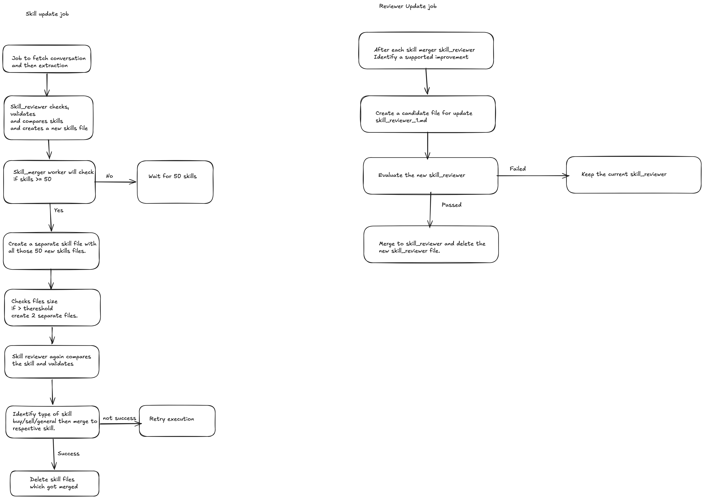

# Skill Update and Reviewer Update Jobs — Implementation Guide

**Status:** Design proposal for review. This document describes a future workflow; it does not claim the jobs are implemented.
**Source:** The attached skill update and reviewer update diagram.
**Repository context:** The current application is Python/FastAPI with SQLAlchemy, PostgreSQL, file-based Markdown skills, and a database-backed `skill_reviews` worker. See `app/workers/skill_reviews.py`, `app/skills/loader.py`, and `app/db/models.py`.

## 1. Purpose and interpretation

The diagram describes two related but independent jobs:

1. **Skill update job:** read eligible complete conversations and produce at most one candidate Markdown file per conversation, named for its source type (for example, `buyer_conversation_skill_1.md`). If a conversation has no valid reusable learning, record a no-candidate outcome. Store candidates in a configurable persistent local server directory. When 50 candidates from a source type are available, consolidate and second-review them; the second review assigns the final destination skill. Merge accepted learnings into the active skill files and then delete all 50 source candidates for that successfully completed batch.
2. **Reviewer update job:** after each successful skill merge, ask the active `skill_reviewer` to identify a supported improvement. If one exists, write and evaluate a numbered reviewer candidate, then either keep the current reviewer (failure) or merge the candidate into the active reviewer (success). If there is no supported improvement, record no change and create no candidate file.

The drawing does not specify database schema, storage location, scheduler, LLM contract, or exact size limits. The user has confirmed the batch, destination, merge-success, and reviewer no-change semantics; remaining implementation choices are specified below and size limits are configurable for production testing.

## 2. Diagram behavior, step by step

The following is the original diagram supplied for this proposal. The detailed sections below translate its boxes and arrows into implementation behavior and call out unspecified choices.



### 2.1 Skill update path

1. A background job fetches conversations and prepares extraction inputs.
2. `skill_reviewer` checks and validates the extracted learning, compares it with existing skills, and creates candidate skill files.
3. The skill merger checks how many eligible candidates are waiting.
   - Fewer than 50 candidates with the same conversation/source type: wait for more of that type.
   - 50 or more: claim exactly 50 source-type candidates as one batch.
4. Combine the 50 candidates into a separate consolidated skill artifact.
5. Check the artifact size. If it exceeds a configured limit, split it into two or more bounded artifacts and validate the split as a whole.
6. Run `skill_reviewer` again against the consolidated content. It validates the proposed learnings and assigns each accepted learning to a final destination skill. The source-type prefix helps the reviewer interpret the conversation; it does not force the final destination.
7. Group accepted learnings by final destination and apply them to the matching active file: `skills/buyer.md`, `skills/seller.md`, `skills/portfolio.md`, `skills/general.md`, or `skills/unknown.md`.
8. If the merge execution is unsuccessful, retry according to a bounded retry policy. Keep source candidates until the skill update succeeds.
9. Merge success means all accepted learnings have been added to their destination active skill files and the batch result is recorded. Then delete all 50 source candidate files claimed by that completed batch after verifying their manifest hashes. Keep candidates if processing or file updates fail.

### 2.2 Reviewer update path

1. After a customer batch changes at least one active skill, start a reviewer update job. If the batch completes with no accepted changes, record the batch outcome but do not run reviewer self-improvement.
2. The active `skill_reviewer` identifies a supported improvement to its own review instructions.
3. Write a numbered candidate such as `skill_reviewer_1.md`.
4. Evaluate the proposed reviewer against a fixed evaluation set.
5. On failure, keep the currently active reviewer and record the candidate and failure result for diagnosis/retry.
6. On success, merge the improvement into `skills/skill_reviewer.md` and delete the temporary reviewer candidate only after the update is durably recorded. If the reviewer finds no supported change, record a no-change result and do not create a candidate.

The reviewer update is a separate lane. A reviewer candidate must never be merged into a customer skill, and customer learning must not be written into the reviewer instructions. Reviewer candidates are evaluated and merged individually; they do not wait for a 50-file batch.

## 3. Proposed code and local storage layout

The application code and active skill files remain in the project. Candidate Markdown files and temporary artifacts are stored on the server's persistent local filesystem, outside the Git repository. The exact storage root is configurable. An administrator manually handles preserving and carrying local active skill updates across deployments/restarts.

```text
app/
  skill_updates/
    __init__.py
    schemas.py                 # validated reviewer output and batch manifest models
    selection.py               # eligible conversation query and stable cursor
    extraction.py              # ordered transcript snapshot + de-identification
    candidates.py              # candidate ID allocation, write/read, hash checking
    batching.py                # claim exact batch size; leases and manifest
    consolidation.py           # combine, size check, deterministic splitting
    validation.py              # format, evidence, policy, regression checks
    routing.py                 # buyer/seller/general/portfolio/unknown destination classification
    merge.py                   # prepare candidate active-skill update
    cleanup.py                 # exact manifest-based source cleanup
    reviewer_updates.py        # separate reviewer candidate/evaluation lifecycle
  workers/
    skill_updates.py            # skill update worker entrypoint
    reviewer_updates.py         # reviewer improvement worker entrypoint
skills/
  buyer.md                      # current buyer skill (active runtime input)
  seller.md                     # current seller skill (active runtime input)
  portfolio.md                  # current portfolio skill (active runtime input)
  general.md                    # current general skill (active runtime input)
  unknown.md                    # current unknown-intent skill (active runtime input)
  skill_reviewer.md             # current offline review rubric
  evaluations/
    reviewer_cases.jsonl         # fixed, versioned reviewer evaluation corpus
<SKILL_UPDATE_STORAGE_DIR>/      # configured persistent local directory; not committed to Git
  candidates/
    buyer/                        # buyer_conversation_skill_N.md
    seller/                       # seller_conversation_skill_N.md
    portfolio/                    # portfolio_conversation_skill_N.md
    general/                      # general_conversation_skill_N.md
    unknown/                      # unknown_conversation_skill_N.md
    reviewer/                     # skill_reviewer_N.md
  work/                           # temporary transcript snapshots and consolidation artifacts
docs/
  skill-update-operations.md    # schedule, retries, recovery, alerts and retention
migrations/versions/
  <revision>_skill_update_jobs.py
tests/
  test_skill_update_selection.py
  test_skill_update_candidates.py
  test_skill_update_batching.py
  test_skill_update_consolidation.py
  test_skill_update_validation.py
  test_skill_update_merge.py
  test_reviewer_update_job.py
```

Candidate `.md` files are durable local filesystem artifacts under `<SKILL_UPDATE_STORAGE_DIR>/candidates/`; they are not written to Git and are not runtime skills. Temporary transcripts and consolidation artifacts belong under `<SKILL_UPDATE_STORAGE_DIR>/work/` and follow the configured retention policy. The database stores operational details such as IDs, statuses, hashes, sequence allocation, leases, batch membership, evidence references, validation results, and retries. It stores candidate paths and hashes, not a duplicate candidate body. The local filesystem is the authoritative store for candidate text.

Configure the storage root on a persistent server volume with restrictive permissions and enough free space. It must survive application restarts and must not point into a temporary directory or be served by the web server. Runtime skill loading must explicitly enumerate the active files under `skills/` and never search the candidate storage directory. The merge worker updates the active local skill files only after validation; use atomic writes with backups/recovery so an interrupted multi-file update cannot leave a partially written skill set. No Git push, branch, or repository writer is part of this workflow.

## 4. Data model proposal

Use the database as the source of truth for job state and batch manifests. Candidate text is stored in the configured persistent local directory and addressed by stable IDs and hashes. New tables are a proposal; reuse existing `SkillReviewRun` only where its semantics fit, rather than overloading the current aggregate-only proposal model.

### `skill_update_runs`

One extraction/review execution.

| Field                                     | Meaning                                                     |
| ----------------------------------------- | ----------------------------------------------------------- |
| `id` UUID primary key                     | Stable run identifier.                                      |
| `status`                                  | `queued`, `running`, `completed`, `partial`, `failed`.      |
| `selection_json`                          | Time range, eligibility policy version, cursor, and limits. |
| `reviewer_release`                        | Exact active reviewer version used.                         |
| `conversation_count`, `candidate_count`   | Work counters.                                              |
| `lease_owner`, `lease_expires_at`         | Recovery and duplicate-worker protection.                   |
| `attempt_count`, `error_code`, timestamps | Retry and audit fields.                                     |

### `skill_candidate_files`

At most one validated learning candidate from one complete conversation snapshot.

| Field                                            | Meaning                                                                   |
| ------------------------------------------------ | ------------------------------------------------------------------------- |
| `id` UUID primary key, `source_type`, `sequence` | Stable ID and monotonic filename number, unique per source type.          |
| `run_id`, `conversation_id`                      | Producing update run and the single source conversation.                  |
| `candidate_type`                                 | `customer_skill` or `reviewer_skill`.                                     |
| `source_conversation_type`                       | `buyer`, `seller`, `portfolio`, `general`, or `unknown`; null for reviewer candidates. |
| `target_skill_key` nullable                      | Final destination: `buyer`, `seller`, `portfolio`, `general`, `unknown`, or `skill_reviewer`. |
| `status`                                         | `writing`, `pending`, `claimed`, `merged`, `rejected`, `cleanup_pending`, `cleaned`. |
| `relative_path`, `sha256`                        | Artifact location and immutable-content check.                            |
| `evidence_refs_json`, `regression_cases_json`    | Opaque references and declarative checks.                                 |
| `source_skill_version`, `source_snapshot_ids_json` | Reproducibility/version lineage.                                        |
| timestamps                                       | Creation and lifecycle audit.                                             |

Allocate a separate monotonically increasing sequence for each `source_conversation_type` and for reviewer candidates. Enforce one candidate maximum per conversation with a unique idempotency constraint on the source conversation/candidate type (plus reviewer release where needed). A no-candidate outcome is stored in the run result. Do not use raw phone numbers or names in paths, manifests, or evidence identifiers.

The implementation uses a `skill_candidate_sequences` row per source type and for `reviewer`, updated transactionally when allocating the next filename number. The `writing` candidate state records the interval after the metadata/sequence reservation and before the candidate file hash is durably recorded.

### `skill_consolidation_batches`

One exact set of candidate files and its proposed merge.

| Field                                          | Meaning                                                                                                         |
| ---------------------------------------------- | --------------------------------------------------------------------------------------------------------------- |
| `id` UUID primary key                          | Batch ID.                                                                                                       |
| `source_conversation_type`                     | One of `buyer`, `seller`, `portfolio`, `general`, or `unknown`; each batch contains 50 candidates of one source type. |
| `status`                                       | `claimed`, `consolidating`, `validating`, `updating_skills`, `completed`, `cleanup_pending`, `cleaned`, `failed`. |
| `candidate_ids_json`                           | Ordered allowlist of exactly 50 candidates from one source conversation type.                                    |
| `manifest_sha256`                              | Integrity check for the frozen manifest.                                                                        |
| `base_skill_hashes_json`, `target_skill_keys_json` | Optimistic concurrency and destinations assigned by the second review; one source batch may update multiple targets. |
| `artifact_paths_json`, `validation_json`       | Consolidated parts and machine-readable results.                                                                |
| `active_skill_update_id`                       | Durable local update record linking the batch to the active skill file changes.                                |
| `attempt_count`, `next_attempt_at`, timestamps | Retry scheduling and audit.                                                                                     |

### `reviewer_evaluations`

Store the fixed suite version, active and candidate reviewer hashes, per-case results, aggregate metrics, pass/fail decision, and evaluator release. The decision must be reproducible from stored inputs.

## 5. File formats and naming

Suggested inactive customer candidate format:

```markdown
---
candidate_id: 1042
candidate_type: customer_skill
source_conversation_type: buyer
target_skill_key: null  # assigned by second review
source_run_id: "<uuid>"
source_skill_version: "<active-skill-version-or-hash>"
confidence: 0.91
evidence_refs: ["ev_opaque_1", "ev_opaque_2"]
---

## Learning

Ask for the budget currency when the customer gives a budget without one.

## Regression cases

- Given a buyer says "budget is 2 million", ask which currency before recording a normalized amount.
```

Store files under `<SKILL_UPDATE_STORAGE_DIR>/candidates/<source_type>/` using the source conversation type in the filename, for example the first buyer batch is `buyer_conversation_skill_1.md` through `buyer_conversation_skill_50.md`. Continue numbering monotonically for later batches rather than reusing names. Use the same pattern for seller, portfolio, general, and unknown conversations. The second review may assign a different final `target_skill_key`. Reviewer candidates use `<SKILL_UPDATE_STORAGE_DIR>/candidates/reviewer/skill_reviewer_1.md`, and are evaluated and merged individually. Allocate sequences transactionally per type; never infer the next number by scanning filenames alone. Validate front matter, content size, allowed target, evidence reference format, and absence of personal data before writing with an atomic temp-file-plus-rename operation. Store metadata in the database and candidate text only in the local Markdown file.

The active skill files must continue to satisfy the metadata contract in `app/skills/loader.py` (`key`, `release`, `intent`, triggers, required/optional fields) or a deliberately versioned replacement contract. Merging a learning into an active file must preserve its metadata and required instructions.

## 6. End-to-end processing details

### 6.1 Job schedule and selection

- Trigger the conversation skill job on a configurable schedule and permit an authenticated/manual enqueue path if operations require one.
- Select a bounded, stable cohort of eligible conversations. Persist the query window and cursor in the run record so retries do not skip or duplicate work.
- Include recently active `active_agent` conversations as well as closed conversations. For active conversations, freeze the message cutoff at the run window end and page by the latest customer-message timestamp within that window. Exclude `admin_owned` conversations.
- Exclude records prohibited by retention, deletion, legal hold, or policy. Consent status does not gate skill learning. Include only customer-visible turns needed to understand the outcome; omit private admin notes and unrelated context.
- Fetch full selected conversation histories in timestamp/sequence order. Preserve message IDs as opaque evidence references.
- De-identify direct identifiers before any model input, persist a snapshot hash, and apply retention/access controls to raw snapshots.
- Pin each run to the deployed application release, active skill hashes, reviewer hash, prompt/schema versions, and model configuration identifier (never credentials).

The current `skill_reviews` worker aggregates handover reason codes and creates pending human proposals; it does not currently perform full-history extraction or local skill updates. This job is a staged replacement/extension and requires an explicit product decision on transcript eligibility and retention.

### 6.2 Extraction, comparison, and candidate creation

The first review should return structured output, not free-form Markdown alone. Validate at least: `lesson`, `source_conversation_type`, `trigger`, `instruction`, `evidence_refs`, `confidence`, `duplicate_or_novel`, `policy_conflicts`, and `regression_cases`. Determine source type from the conversation's persisted primary intent/skill, not a fresh unconstrained guess: map `buy` to `buyer`, `sell` to `seller`, and preserve `portfolio`, `general`, or `unknown`. If persisted intent is `mixed`, use `general` as the source type; if it is missing or invalid, use `unknown`. The second review may still route each learning to a different final target. Create no more than one candidate from the complete conversation; if there is no supported reusable lesson, record no-candidate. Reject output with unknown evidence references, unsupported claims, unsafe policy conflicts, personal data, invalid source type, or malformed regression cases.

Compare the proposed behavior against all relevant active skills and pending candidates. Deduplicate by semantic comparison plus deterministic normalized-content fingerprint. Never silently overwrite an active instruction. If the new lesson conflicts with a safety or consent rule, fail closed and retain a diagnostic record for operator follow-up.

The second review assigns a final `target_skill_key` from `buyer`, `seller`, `portfolio`, `general`, or `unknown`, matching the active skill files. The source type remains in the filename and database for traceability. A high-confidence, unambiguous learning routes to one target; ambiguous classification is rejected/parked with a recorded reason. `skill_reviewer` is not a customer skill destination.

### 6.3 Batch claim and consolidation

Only eligible `pending` candidates for the same source conversation type count toward the 50-file threshold. Maintain independent queues and sequence allocation for buyer, seller, portfolio, general, and unknown source types. In a single database transaction, lock/claim exactly 50 for one source type in sequence order (`FOR UPDATE SKIP LOCKED` on PostgreSQL), create the batch row, store the ordered IDs and hashes, then mark candidates `claimed`. A uniqueness constraint or lock prevents overlapping batches. If a type has fewer than 50 pending candidates, wait for that type. Multiple source types may each have a ready batch at once. The second review can route learnings from one source-type batch to one or more final skill targets.

The consolidator groups equivalent lessons, retains evidence lineage, and produces a temporary artifact for the source-type batch. The second reviewer validates each learning and assigns its final target. Keep each of the 50 candidates accounted for as `incorporated`, `already_covered`, or `rejected`, with a reason and target where applicable. If processing succeeds, apply all accepted learnings to the relevant active skill file(s), record the batch result, and delete all 50 source candidate files, including those marked already covered or rejected. If consolidation, review, or an active-file update fails, keep all 50 candidates for retry/diagnosis. Retain the database manifest and outcomes after file cleanup.

### 6.4 Size limit and splitting

The consolidated temporary artifact and active skill size limits must be configurable for production testing. For example, use `SKILL_CONSOLIDATED_MAX_BYTES` and `SKILL_ACTIVE_MAX_BYTES`, measuring UTF-8 bytes. When a temporary artifact exceeds its limit, split only at complete learning/rule boundaries into numbered parts; do not cut a rule or regression case. Each part carries the same batch ID and unique part index. Validate all parts together and apply them as one atomic update to the matching active skill. If the resulting active skill exceeds its configured limit, fail without changing the active file and retain candidates for retry or diagnosis. Tune initial values using observed artifact sizes and model context limits.

These limits must be set after checking model context limits and operational readability. The threshold is not a security boundary; reject oversized input and output before invoking expensive downstream steps.

### 6.5 Second review, validation, and merge

Run the reviewer a second time on the proposed consolidated change with the active skill set and candidate evidence. It validates and categorizes each learning to one of the five customer skills. This is an independent validation pass in intent, though using the same model/reviewer is not statistically independent; add deterministic validators and regression checks so the reviewer is not the sole gate.

Validation should include:

- Active skill metadata and Markdown structure parse successfully.
- Proposed changes affect only the customer skill file or files assigned by the second review and preserve safety/consent instructions.
- Every accepted rule traces to at least one candidate and opaque evidence reference.
- No candidate introduces unsupported property, price, legal, financial, availability, or matching claims.
- Regression cases pass against the proposed skill and the existing skill test suite.
- Every destination skill hash still matches the hash used to build the proposal; otherwise rebuild against the latest files and rerun validation.
- Size limits and duplicate/contradiction checks pass.

After checks pass, atomically update the matching local active file or files in `skills/` (`buyer.md`, `seller.md`, `portfolio.md`, `general.md`, and/or `unknown.md`). Stage new contents and backups first; replace files only after all updates are ready, and recover the prior contents if any replacement fails. The successful local skill-file update and recorded batch result are the merge success point. Candidate files never become runtime inputs. The job does not commit or push changes to Git.

### 6.6 Retry and failure handling

Use bounded exponential backoff with jitter for transient database/model/provider errors. Separate transient failures from permanent validation failures. A failed validation should not be retried unchanged indefinitely; retain the output, failure codes, and attempt history, then park/alert it. If an active skill changed while a proposal was prepared, rebuild against the new file and rerun validation. A partially completed local file write is restored from backup or reconciled using the database update record and hash.

No failure may leave an active skill partially updated or delete batch candidates. After all accepted learnings are applied and the batch result is durable, cleanup reads the manifest, verifies each candidate's recorded hash, and deletes all 50 listed files. Cleanup is idempotent; unexpected/mismatched files stop cleanup and alert. Keep the database manifest, hashes, evidence references, merge diff, validation results, and update ID according to retention policy.

## 7. Reviewer self-improvement workflow

### Trigger and candidate

Queue this lane only after a customer skill merge succeeds, as drawn. Pin the run to the just-completed batch, current `skill_reviewer.md` hash, active customer skill version, evaluator version, and fixed evaluation suite. The reviewer evaluator may inspect deterministic failures such as malformed structured output, unsupported claims, missing evidence, duplicate rate, or regression failures. It must not create an improvement based only on the reviewer's own assertion that it needs one. If evaluation identifies no supported reviewer change, record a no-change outcome and do not create a reviewer candidate file.

Write at most one narrowly scoped reviewer candidate per trigger unless product policy explicitly allows more. The candidate can improve review instructions, evidence thresholds, comparison logic, or output schema. It cannot change customer-facing behavior, selection eligibility, consent rules, or cleanup permissions.

### Evaluation and activation

Run both current and candidate reviewer versions against the same versioned, de-identified fixed corpus. Compare required schema compliance, evidence accuracy, duplicate detection, policy violations, and regression outcomes. Define pass thresholds and a no-regression policy before implementation. If the candidate fails, retain the current reviewer and record the failed candidate and metrics; whether to retry is determined by an explicit transient/permanent error classification.

If it passes, create a validated update to the existing `skills/skill_reviewer.md`, record the evaluation and manifest, and remove the reviewer candidate after the update is durably recorded. Preserve evaluation inputs/outputs subject to data retention policy. Pin all in-flight runs so a reviewer update cannot change the rubric midway through processing.

## 8. Security, privacy, and operational controls

- Runtime skill loading must explicitly enumerate active customer skills; never glob candidate, consolidated, or evaluation folders.
- Skill jobs receive read-only access to eligible de-identified snapshots and active skill files; only the merge component may update active skills. Cleanup may delete only manifest-listed candidates after the batch update is durable.
- Model output is untrusted data. Parse against schemas, escape Markdown as appropriate, enforce path allowlists, and never execute generated content.
- Exclude private admin notes and secrets. Redact names, phone numbers, email addresses, URLs, and addresses as feasible; retain opaque evidence IDs only.
- Apply least privilege, encryption in transit/at rest, access auditing, retention limits, and deletion policy to transcript snapshots and artifacts.
- Emit metrics for selected conversations, extraction failures, rejected/duplicate candidates, pending candidate age, batch claims, size splits, validation results, retries, active-file update failures, cleanup failures, and reviewer evaluation deltas.
- Alert on stuck leases, exhausted retries, hash mismatches, missing candidates, a skill update that changes active content without a batch record, and reviewer regressions.
- Keep the active skill unchanged on any failed or incomplete operation.

## 9. Required code and repository changes

This is the proposed change inventory for implementation. Names can be adjusted to match established project conventions, but each responsibility must remain testable and separate.

| Area                     | Existing location                                                                                 | Required change                                                                                                                                                                                                                                                                                       |
| ------------------------ | ------------------------------------------------------------------------------------------------- | ----------------------------------------------------------------------------------------------------------------------------------------------------------------------------------------------------------------------------------------------------------------------------------------------------- |
| Runtime skill loading    | `app/skills/loader.py`                                                                            | Replace broad `*.md` discovery with an explicit allowlist for `buyer`, `seller`, `portfolio`, `general`, `unknown`, and `skill_reviewer`. Add missing active skill files using the existing metadata contract. Never load files from the configured candidate/work directory. |
| Skill update domain      | New `app/skill_updates/` package                                                                  | Add typed schemas, eligible conversation selection, transcript snapshots/de-identification, candidate validation, deduplication, transactional IDs, batch claiming, consolidation, routing, merge checks, and manifest-scoped cleanup. Keep model calls behind an adapter that can be faked in tests. |
| Worker entrypoints       | Existing `app/workers/`                                                                           | Add separately runnable `skill_updates` and `reviewer_updates` workers, following the session factory, settings, lease, and graceful-shutdown conventions used by current workers. Do not silently replace `skill_reviews` until migration and API compatibility are decided.                         |
| Database state           | `app/db/models.py` and new Alembic migration                                                      | Add run, candidate metadata, batch/manifest, and reviewer evaluation records; indexes, unique idempotency constraints, status checks, timestamps, leases, and migration downgrade behavior. Store candidate path/hash and operational metadata, not candidate Markdown bodies.                        |
| Configuration            | `app/config/settings.py`, `.env.example`                                                          | Add flags, schedule/selection limits, per-source-type batch size (50), persistent local candidate root, configurable artifact/active skill size limits, retry policy, and reviewer evaluation thresholds. Validate storage paths and filesystem permissions. |
| Local candidate storage  | New filesystem adapter and settings                                                               | Write candidate `.md` files under `<SKILL_UPDATE_STORAGE_DIR>/candidates/<source_type>/`; write temporary snapshots/consolidations under `work/`. Use atomic writes, strict path allowlists, hashes, and manifest-only deletion. Nothing is committed or pushed to Git. |
| Active skill merge       | `skills/buyer.md`, `skills/seller.md`, `skills/portfolio.md`, `skills/general.md`, `skills/unknown.md`, `skills/skill_reviewer.md` | Ensure all five customer skill files exist and preserve metadata/behavior. Apply validated updates to local files with backups, atomic replacement/recovery, and base-hash checks. Candidate files stay separate. |
| Reviewer instructions    | `skills/skill_reviewer.md`                                                                        | Extend the offline review contract to emit schema-constrained evidence-backed findings and, in the reviewer lane only, constrained reviewer-improvement proposals. Pin jobs to a reviewer hash so changes do not affect an in-flight run.                                                             |
| API/admin visibility     | `app/api/routes/admin.py`, `app/api/schemas/` (only if required)                                  | Decide whether operators need read-only run/batch status and retry endpoints. Expose status and sanitized error codes; do not expose raw transcript snapshots or provide an unreviewed “approve” endpoint if the intended pipeline is automated.                                                      |
| Tests                    | `tests/`                                                                                          | Add focused tests for path isolation, local candidate persistence, retries, batch races, exact-50 selection, size splitting, second review categorization, active-file rollback, hash mismatch, cleanup idempotency, and individual reviewer evaluation pass/fail. Use deterministic model/filesystem fakes. |
| Documentation/operations | This guide and new `docs/skill-update-operations.md`                                              | Document configuration, launch sequence, job replay, stuck lease recovery, filesystem recovery, candidate retention, rollback, and alert response. Revise conflicting skill update descriptions in `IMPLEMENTATION_GUIDE.md` so there is one agreed design. |

### Local storage contract

1. `<SKILL_UPDATE_STORAGE_DIR>/candidates/<source_type>/*.md` and `reviewer/*.md` are durable candidate text on the server's persistent local filesystem. Customer source types are `buyer`, `seller`, `portfolio`, `general`, and `unknown`.
2. The database stores candidate ID, type, path, hash, status, source/run IDs, target skill, evidence references, validation outcomes, timestamps, and batch linkage. It does not store a second authoritative copy of Markdown content.
3. `<SKILL_UPDATE_STORAGE_DIR>/work/` contains ephemeral snapshots and consolidated proposals. Restrict access and clean according to retention policy.
4. Candidate files must contain de-identified learnings and opaque evidence IDs, never raw transcripts or direct identifiers. Restrict filesystem access to the application/service account.
5. For candidate creation, persist the allocated DB row/sequence, write the `.md` atomically, compute its hash, then mark the DB record available. Reconcile crashes idempotently. For cleanup, verify the manifest hashes and delete all 50 candidate paths only after the active skill update and batch result are durable. If the filesystem and database disagree, stop and reconcile rather than guessing.

## 10. Milestone-by-milestone implementation guide

Each milestone is a small, reviewable code change. A coding agent should read this document and the affected modules first, implement only the named milestone, keep active customer behavior unchanged until the designated activation milestone, and report changed files, migration requirements, and checks performed. Do not begin a later milestone while its dependencies or acceptance criteria are unresolved.

### Milestone 0 — Resolve implementation contracts

**Read:** this guide, `IMPLEMENTATION_GUIDE.md`, `app/skills/loader.py`, `app/workers/skill_reviews.py`, `app/db/models.py`, and `app/config/settings.py`.

**Implement:** preserve the confirmed policies in this guide: at most one candidate per complete conversation, 50 source-type candidates per batch, a temporary consolidation artifact, configurable size limits, second-review destination categorization, local active-file updates without Git push, deletion of all 50 candidates after successful batch processing, individual reviewer candidate evaluation, no candidate when there is no reviewer change, and admin-managed active skill preservation across deployment. Resolve remaining operational policies such as cohort eligibility/retention, persistent candidate volume, retry ceilings, reviewer evaluation thresholds, and whether existing aggregate-only skill review APIs remain during transition.

**Exit criteria:** decisions are written down; no production behavior changes. If policy choices remain open, implement only independent scaffolding and leave activation disabled.

### Milestone 1 — Isolate active runtime skills

**Read:** `app/skills/loader.py`, all current `skills/*.md`, skill loader tests.

**Implement:** an explicit active-skill manifest/allowlist; ensure all five customer files exist with valid metadata; validate that candidate/work paths cannot be loaded. Configure the persistent local candidate root outside the project repository.

**Exit criteria:** current runtime skill set loads identically; candidate-looking Markdown placed in candidate/work directories is excluded; loader fails clearly if a required active skill is missing. No candidates are created by workers yet.

### Milestone 2 — Persistence schema and configuration

**Read:** SQLAlchemy model/migration patterns in `app/db/models.py` and `migrations/versions/`, settings conventions, worker lease patterns in `app/workers/skill_reviews.py`.

**Implement:** run, candidate metadata, batch, and reviewer evaluation tables; status constraints, sequence uniqueness, idempotency constraints, leases, indexes, and timestamps. Add settings for enable flags, schedule/cohort bounds, batch count, size thresholds, retry policy, and paths. Persist paths/hashes/metadata only; never add Markdown body columns.

**Exit criteria:** migration applies and downgrades on the project's supported local DB checks; settings reject invalid/unsafe paths and malformed thresholds; auto-merge remains disabled by default.

### Milestone 3 — Local filesystem artifact adapter

**Read:** configured local storage layout, current skill loader, database transaction boundaries, and file permission conventions.

**Implement:** a narrow interface for writing, reading, hashing, and deleting allowlisted `.md` candidate paths on the persistent local volume. Implement crash reconciliation between DB state and filesystem state. Create test fakes and enforce no arbitrary path, symlink escape, wildcard deletion, or raw transcript content. Do not use Git operations.

**Exit criteria:** a test candidate can be written under `<SKILL_UPDATE_STORAGE_DIR>/candidates/buyer/`, retrieved by DB path/hash, and removed only by an explicit manifest; temporary content remains isolated from runtime skill loading.

### Milestone 4 — Conversation selection and snapshots (shadow mode)

**Read:** conversation/message models, consent and deletion rules, export de-identification code, retention policy, worker queue/lease conventions.

**Implement:** bounded stable selection with persisted cursor/filters; eligibility checks; full ordered transcript snapshot; inclusion of customer-visible admin replies where policy permits; exclusion of private notes; de-identification, opaque message refs, snapshot hash, and retention metadata. Pin active skill/reviewer hashes and application release. Enforce at most one candidate per complete conversation.

**Exit criteria:** deterministic fixture conversations produce stable, de-identified snapshots; ineligible records are excluded; no candidate or active skill file is written; reruns are idempotent.

### Milestone 5 — Extraction, validation, and candidate files

**Read:** `skills/skill_reviewer.md`, skill schemas, candidate format and policy rules in this guide.

**Implement:** typed model output contract, model adapter, evidence verification, policy/schema/privacy validation, duplicate comparison, source-type assignment, regression case checks, DB sequence allocation, and local candidate file creation. Name candidates `<source_type>_conversation_skill_N.md`. Record rejection/no-change outcomes in DB without writing `.md` files.

**Exit criteria:** valid novel fixture output creates one de-identified candidate `.md` in the correct local source-type folder and a DB metadata row with matching hash; invalid, duplicate, weak, or conflicting outputs create no candidate; active skills remain untouched.

### Milestone 6 — Exact batch claim and consolidation

**Read:** transaction/locking patterns, candidate state machine, configured batch size, size policy.

**Implement:** maintain separate queues for source types `buyer`, `seller`, `portfolio`, `general`, and `unknown`; atomically claim exactly 50 candidates of one source type, create an immutable ordered manifest, verify hashes, consolidate to a temporary artifact, split at rule boundaries under configurable limits, and account for every source candidate. The second review assigns final targets and may group updates to multiple active skills.

**Exit criteria:** fewer than 50 does nothing; concurrent workers cannot overlap; exactly 50 are claimed once; byte-limit splitting never breaks a rule; tampered/missing candidates fail closed and remain available for investigation.

### Milestone 7 — Second review, regression validation, and merge proposal

**Read:** active skill metadata, tests, merge format, local active-file update and rollback behavior.

**Implement:** second reviewer pass to categorize each learning to buyer/seller/portfolio/general/unknown; deterministic format, policy, evidence, size, duplicate, and regression validation; active skill base-hash checks; rebuild/revalidate if active files change. Prepare all target file contents and persist validation evidence before applying the local file updates.

**Exit criteria:** failing checks do not change active skills; passing checks produce validated local updates; all 50 inputs are accounted for; active-file conflict forces recomputation and full revalidation.

### Milestone 8 — Controlled activation, retries, and cleanup

**Read:** local skill file paths, rollback process, filesystem adapter, cleanup state machine, operations guide.

**Implement:** bounded retry/backoff and permanent failure parking; active skill file update verification as the merge success point; cleanup removing exactly the manifest-listed, hash-matching candidates; idempotent recovery and audit metadata. Keep feature flag off until staging proves recovery and rollback. Deployment/release verification is not required before candidate cleanup.

**Exit criteria:** injected failures at each stage leave active skills unchanged and candidates intact; successful batch processing updates only second-review destinations and then removes all 50 claimed candidates; replay is safe after crashes between database and filesystem operations.

### Milestone 9 — Reviewer self-update lane

**Read:** reviewer prompt, fixed evaluation corpus, candidate and batch models, metrics and rollout rules.

**Implement:** enqueue after successful customer skill batch merge; produce a reviewer-only candidate only when evaluation finds a supported improvement; if there is no improvement, record no-change and create no file. Compare current and candidate versions on the fixed corpus; persist case-level and aggregate results; evaluate and merge each reviewer candidate individually if thresholds and no-regression rules pass. Use its own sequence and local candidate directory.

**Exit criteria:** customer skill candidates cannot enter this lane; reviewer candidates cannot route to customer skills; failed evaluation makes no active change; passing evaluation updates the active local `skill_reviewer.md` and removes only that evaluated candidate after its outcome is durable.

### Milestone 10 — Operations, observability, and staged enablement

**Read:** all workflow states, local filesystem persistence, privacy retention and alerting setup.

**Implement:** `docs/skill-update-operations.md`, metrics and alerts, operator status/retry visibility if needed, runbook for stale leases/filesystem/hash mismatches/rollback, shadow comparison, staging rehearsal, and per-lane feature flags. Enable extraction, candidate writing, consolidation, and active local file updates in separate controlled steps.

**Exit criteria:** staging demonstrates the full success and failure paths; operational ownership and rollback are documented; production flags remain at the approved rollout level; existing skill review endpoints have a migration/deprecation plan.

## 11. Suggested rollout sequence

1. **Contract and policy:** decide eligible conversations, retention/deletion handling, data retention, per-source-type 50-file thresholds, configurable file-size limits, quality thresholds, and persistent local storage/backup behavior. Messaging consent does not gate skill learning; outbound consent and opt-out rules remain separate.
2. **State and artifacts:** add run/candidate/batch/evaluation records, per-source-type queues, manifest hashing, transactional per-type ID allocation, leases, and explicit runtime skill allowlisting.
3. **Read-only shadow extraction:** select/de-identify conversations and log proposed structured findings without writing candidate files or changing skills.
4. **Candidate generation:** write inactive candidate artifacts; validate and deduplicate; observe quality and privacy metrics.
5. **Batch simulation:** claim synthetic/test batches, consolidate, split, run both validation passes and regressions, and exercise retries/cleanup in isolated temporary storage.
6. **Controlled skill merge:** update the active local skill files after validation, with backup and rollback. No Git push is performed by the job. Enable automatic local updates only after failure recovery is proven.
7. **Reviewer update lane:** add fixed-corpus comparison and evaluation records; run in shadow before enabling individual local reviewer updates.
8. **Operations:** document on-call recovery, replay, retry, rollback, artifact retention, and alert response in `docs/skill-update-operations.md`.

## 12. Acceptance criteria

- Each selected complete conversation produces at most one candidate file; its full context is extracted in stable order, de-identified, hashed, and pinned to skill/reviewer versions.
- Invalid, duplicate, weakly evidenced, or conflicting learnings do not become active skill instructions.
- Candidate sequence allocation is unique within each skill type across concurrent workers; each customer batch contains exactly 50 candidates of one type, and each type waits independently for its threshold.
- A batch manifest freezes source IDs and hashes; no two jobs can claim the same candidate.
- Oversized consolidated output splits at rule boundaries, and all parts are validated and merged atomically into the selected destination.
- The second review and deterministic regression/policy checks pass before active local skill files are updated.
- Failed extraction, validation, or merge leaves active skill files unchanged and preserves candidates for diagnosis/retry. Git commit/push and deployment are not merge-success or cleanup gates.
- Successful cleanup deletes exactly the hash-matching manifest-listed sources and is safe to retry.
- Reviewer updates are triggered only after a batch changes at least one active customer skill, use an independent candidate namespace and fixed evaluation suite, and cannot modify customer skills.
- Failed reviewer evaluation leaves the active reviewer unchanged; successful update preserves its evaluation evidence and version lineage.
- Runtime loads only active buyer, seller, general, portfolio, unknown, and reviewer skills as explicitly configured; candidates and temporary files are never loaded.
- Metrics, audit records, retention, retry ceilings, rollback, and operator recovery procedures are defined before production activation.

## 13. Confirmed decisions and remaining implementation choices

The following decisions are confirmed and should be treated as requirements by implementation agents:

- Keep independent candidate queues for `buyer`, `seller`, `general`, `portfolio`, and `unknown`; each type becomes eligible when it has 50 pending candidates. A batch contains exactly 50 candidates of one type.
- A complete conversation produces at most one candidate, and only when it yields a valid reusable learning. Otherwise, record a no-candidate outcome in the database.
- The consolidated file is a temporary artifact. Review it, validate it, then merge its accepted learning into the corresponding existing active skill file.
- Candidate and active skill size limits are configurable. Choose initial values suitable for production testing and tune them from observed sizes and model context limits.
- Merge success means the new learning has been added to the corresponding active skill file. Candidate cleanup follows that successful update and hash verification; it does not wait for deployment completion.
- Run reviewer improvement analysis after a successful skill batch changes at least one active skill. Evaluate and merge each supported reviewer candidate individually. If there is no supported change, record no change and do not create a reviewer candidate file.
- The active skill mapping is `buyer.md`, `seller.md`, `general.md`, `portfolio.md`, and `unknown.md`; reviewer changes target `skill_reviewer.md`.
- Source type comes from the conversation's persisted primary intent/skill: map `buy` to `buyer` and `sell` to `seller`; preserve `portfolio`, `general`, or `unknown`; map `mixed` to `general`; map missing/invalid intent to `unknown`. The second reviewer independently assigns the final target skill.
- Admin manually preserves and carries locally updated active skill files across deployments/restarts; the update job does not commit or push them to Git.
- The alternative `master_skill.md` consolidation workflow is not needed. The deleted `docs/skill-consolidation-workflow.md` must not be recreated as part of this implementation.

The coding agent can resolve remaining operational details in Milestone 0 (conversation eligibility and retention, persistent-volume and active-file backup behavior, retry ceilings, reviewer evaluation thresholds, and whether existing aggregate-only skill review endpoints remain during transition) without reopening the confirmed decisions above.

## 14. Milestone 0 implementation contracts (resolved)

These operational choices complete Milestone 0. They are design contracts for later milestones; they do not enable workers, alter runtime skill loading, or change the existing review APIs.

### Conversation eligibility and privacy

- An eligible conversation is closed or currently `active_agent`, has at least one customer message, and has a complete ordered message snapshot to a fixed cutoff. Active snapshots stop at the run window end (or earlier closure); closed snapshots stop at `closed_at`. Admin-owned conversations are ineligible. A missing or invalid `active_intent` maps to source type `unknown` as already specified; it does not make an otherwise eligible conversation ineligible.
- Consent status does not gate skill learning: contacts with unknown, opted-in, or opted-out status may be processed. Retention must be active and legal hold must be false at selection and again immediately before snapshot/candidate persistence. Pending deletion, anonymized, and legal-hold contacts are excluded. If retention or legal-hold state changes during processing, discard the snapshot and do not create a candidate. Outbound messaging consent and opt-out enforcement remain separate controls.
- Process conversations with a closed timestamp or latest customer-message timestamp within the preceding 90 days. This bounds each cohort and avoids indefinite reuse of old conversational data. The retention/deletion system remains authoritative: deletion or anonymization requests remove related snapshots/candidates/evidence where legally and technically applicable; derived artifacts do not extend the underlying data's retention period. Keep only opaque evidence references in candidate artifacts, never transcript excerpts or direct identifiers.
- De-identified shadow snapshots are stored under the private `work/` directory for at most 7 days, configurable up to 30 days, and are removed sooner when their source data is deleted or anonymized. Keep snapshot metadata (opaque reference, hashes, source conversation ID, and expiry) in the run record; do not put raw database IDs or personal data in artifact filenames or snapshot bodies.
- Snapshot customer-visible inbound/outbound messages, including admin replies, ordered by `(created_at, id)`. Exclude private admin notes, system-only events, and non-text payload contents unless a later version defines a reviewed, de-identified representation. A conversation with no valid reusable learning records a no-candidate outcome.

### Persistent storage, backup, and size limits

- `SKILL_UPDATE_STORAGE_DIR` must be explicitly configured to a persistent local volume outside the repository and outside temporary directories. If absent, non-persistent, inside the repository, or inaccessible, candidate creation and active updates fail closed. Restrict directory and file permissions to the service account; candidate storage must not be web-served.
- Candidate and work artifacts are not backed up as deployable skills. Pending candidates and in-flight manifests must survive process restarts and volume snapshots. Temporary snapshots/consolidation artifacts are removed after a terminal outcome; failed work is retained for diagnosis only for the applicable source-data retention window.
- Administrators remain responsible for carrying locally updated active skill files across deployments/restarts. Before an active-file update, preserve the exact pre-update bytes and hashes in a restricted backup area on the same persistent volume. Apply multi-file updates atomically as a recoverable transaction; retain backups for 30 days after successful verification, and retain them longer while an update is unresolved. Rollback restores the exact prior bytes. No Git commit or push is performed.
- Initial configurable byte limits for production testing: 32 KiB per customer candidate, 256 KiB per consolidated artifact part, and 128 KiB per active skill file. Enforce limits on UTF-8 encoded bytes, split consolidated content only at complete learning/rule boundaries, and reject an individual learning that cannot fit. These are starting caps to be measured and adjusted before activation, not assumptions about model token limits.

### Retries and reviewer evaluation

- Retry transient extraction, validation infrastructure, and filesystem/database coordination failures at most five attempts total, with exponential backoff starting at one minute and capped at six hours. Validation/policy rejection is terminal for that artifact and is not automatically retried. After the ceiling, park the run/batch for operator review; never discard source candidates because of retry exhaustion.
- Reviewer improvement candidates are evaluated individually against a versioned, fixed corpus. A candidate passes only if every required safety/policy case passes, it introduces no regression against the active reviewer, and it improves at least one pre-designated target case. Corpus version, active/candidate hashes, per-case results, and the decision are durable before merge. Missing corpus, evaluator failure, or an indeterminate result is a failure and leaves the active reviewer unchanged. Final corpus size and case coverage are release inputs; expansion of that corpus does not change this pass rule.
- Keep the existing aggregate-only `skill_review_runs` and proposal APIs operational and behavior-compatible during transition. They remain a separate human-review workflow and are not inputs to or substitutes for candidate extraction, batching, merge, or reviewer self-update. Deprecation requires a later explicit migration plan.

### Milestone 0 boundary

The above choices settle Milestone 0's open policies. No schema, settings, worker, loader, API, migration, or active skill behavior is changed by this milestone. Subsequent work must implement these contracts behind disabled-by-default activation flags and may not relax the confirmed policies in section 13.
