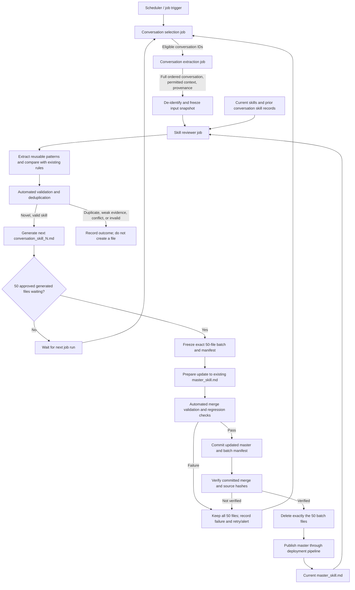

# Automated Skill Generation and Consolidation

**Status:** Proposed implementation

This workflow has no human review step. `skills/master_skill.md` already exists and is the main skill used by the customer runtime. Scheduled jobs select eligible conversations, extract their full context, compare conversation behavior with the current master skill, generate numbered skill files, merge each batch of 50 into the existing master, and delete only the files included in a successfully committed consolidation.

## Full workflow diagram

## Skill file roles

- **`skills/master_skill.md`** is the existing canonical customer-facing skill and the main skill used by the runtime. The workflow reads its current contents and updates it with accepted learning from each completed batch. It is not generated as a workflow output. If legacy skill files remain, the reviewer may consult them as comparison context, but the master remains the runtime source of truth.
- **`skills/skill_reviewer.md`** defines the offline reviewer task and output schema. The reviewer reads the frozen conversation input plus the current master and relevant skill history. It creates candidate skill content; it cannot send customer messages or deploy changes.
- **`skills/conversation_skill_N.md`** is an automatically generated, review-job artifact—not a customer-runtime skill. `N` is a unique monotonically increasing sequence. Each file contains one bounded proposed learning, its evidence references, source skill/master version, confidence and frequency information, and a regression case.
- **Batch manifest** records the exact 50 candidate file names, hashes, source run IDs, source snapshot IDs, and the resulting master commit/release. It remains after candidate files are deleted.

## Detailed implementation

### 1. Select conversations

Run on a configurable schedule or explicit system trigger. Query a bounded, incremental window of completed conversations that have not already been processed for the same reviewer version. Use a stable ordering and selection cursor so retries do not silently skip or repeatedly process the same conversations. A conversation can be selected only if policy permits its use for skill improvement; exclude opted-out, restricted, deleted, legal-hold, or otherwise ineligible records. Do not interpret job selection as permission to retain raw data indefinitely.

Persist a run record with the cohort window, selection filters, eligible conversation count, source application release, reviewer version, and status. Use idempotency keys so a retried run cannot create duplicate candidate records.

### 2. Extract full conversations

For every selected ID, fetch the full conversation in chronological order, including the turns needed to understand the outcome. Include customer-visible admin replies when they are part of the conversational handling and policy permits. Exclude private admin notes and unrelated customer records. Include the skill/master version used for each relevant agent response and only the structured context needed to interpret what was already known at that point in the conversation.

De-identify direct identifiers before sending input to the reviewer. Preserve opaque message references so the generated file can point back to evidence without containing phone numbers, names, or raw transcript dumps. Freeze the extracted input as an immutable snapshot, record its checksum, and enforce access and retention controls. The reviewer must not receive more history than the job selected.

### 3. Generate a candidate skill from the conversation

For each full conversation (or a small coherent group selected by the job), the reviewer performs the following steps:

1. Reconstruct the conversation state at each relevant turn: customer intent, facts already known, questions asked, responses, handovers, and outcome.
2. Identify a reusable behavior lesson, such as a missed clarification, repeated question, successful sequencing choice, or a rule needed to handle a recurring edge case.
3. Compare that lesson against `master_skill.md` and relevant current skills. Classify it as already covered, a refinement, a conflict, or a genuinely new rule.
4. Check evidence strength. A one-off pattern may be stored only if it is directly supported and narrowly scoped; a general rule requires a configurable minimum count of distinct conversations. A single anecdote must not become a broad instruction.
5. Draft one small, actionable instruction in the same style as the master, with scope, triggering condition, and desired behavior. Avoid duplicating existing rules or adding unsupported domain claims.
6. Generate a declarative regression case with input context, relevant conversation state, and expected behavior. Do not generate executable code.
7. Produce structured output and validate required fields, evidence references, policy constraints, size limits, and regression case format.

If the candidate is novel, supported, non-conflicting, and passes validation, write `skills/conversation_skill_N.md` atomically and record its status and hash in the manifest/store. Allocate `N` transactionally to avoid collisions between workers. If it is a duplicate, weakly supported, conflicting with a higher-priority rule, or invalid, record the reason in the run result and create no file. Conflicts should fail closed: keep the current master unchanged and route the item to an automated retry/dead-letter or alert path; there is no human decision step in this workflow.

### 4. Count candidates and freeze a batch

Count only valid generated skill files that are pending consolidation. When 50 are available, atomically claim exactly 50, ordered by sequence number, and create an immutable batch manifest containing their filenames, IDs, and hashes. Files generated after the batch is claimed belong to the next batch. A lock or database transaction prevents two workers from claiming overlapping files.

If fewer than 50 files are pending, leave them in place for a future run. Do not merge a partial batch unless a separate explicit configuration is introduced.

### 5. Merge the 50 files into the existing master

The consolidation job reads the frozen batch and the current version of the existing `master_skill.md`, then produces an updated candidate version of that file. It does not create a new master skill. It should combine equivalent lessons, preserve existing behavior and safety rules, resolve scope carefully, and include only changes supported by the candidate evidence. Each accepted change should retain traceability to one or more source candidate IDs in the batch manifest or generated change metadata.

Before committing, automatically validate:

- Master metadata and required sections parse correctly.
- There are no duplicate or contradictory rules that the validator can detect.
- The master stays within configured size and format limits.
- Each batch record is accounted for as incorporated, redundant with an existing rule, or rejected as invalid, with a machine-readable reason.
- Declarative regression cases pass against the candidate master and the existing skill regression suite passes.
- The master has not changed since the batch was built; if it has, rebase/recompute the candidate and rerun all checks.

On any failure, keep all 50 source files, leave the current master active, record the failure, and retry under bounded retry policy or alert the operator. On success, commit the new master plus batch manifest/change metadata together. The normal deployment pipeline publishes the committed master; candidate files are never loaded by customer runtime.

### 6. Delete the merged candidate files

Cleanup runs only after the successful merge commit is verified. It reads the committed batch manifest as an allowlist, checks each source file still matches its recorded hash, and deletes exactly those 50 files. It must not glob-delete all `conversation_skill_*.md` files. If any hash is different or a file is missing unexpectedly, stop cleanup and record an error rather than deleting other files.

Make deletion idempotent: a retry can recognize already deleted members of the committed batch and finish safely. Record cleanup status and timestamp. Keep the manifest, outcomes, hashes, and evidence references for audit according to retention policy. If source content must be retained, store it in the access-controlled review artifact store before repository deletion.

## Runtime, permissions, and failure handling

The customer runtime loads only the deployed `master_skill.md`; it never loads conversation skill files or reviewer instructions. The extraction/reviewer worker can read eligible conversation snapshots and current skills, and write candidate files and run records. The consolidation worker can read the 50-file batch and propose/commit the master update only through the controlled repository pipeline. Cleanup can delete only manifest-listed files for a verified successful commit. No model-generated text is executed as code.

Use separate run, candidate, and consolidation states, such as `queued`, `running`, `completed`, `failed`, `pending_merge`, `merged`, and `cleaned`. Record retries and errors. Keep the active master unchanged on any extraction, validation, merge, commit, or deployment failure. Alert on repeated failures, but do not introduce an approval step; automated policy and deterministic checks decide whether the workflow proceeds.

## Migration from the current implementation

The current repository's skill-review worker aggregates de-identified operational reason codes into human-review proposals. It does not extract full conversations, generate `conversation_skill_N.md` files, merge a master, or delete merged files. Implement this workflow as a staged replacement:

1. Confirm `skills/master_skill.md` exists, is the runtime's main skill, and has a recorded version/release identifier. Do not generate a replacement master.
2. Add eligible conversation selection, full-history extraction, de-identification, snapshots, and run tracking.
3. Add structured reviewer output, comparison against the existing master, evidence checks, uniqueness allocation, candidate writing, and deduplication.
4. Add automated regression validation and a shadow period that records what would be generated without changing the active master.
5. Enable candidate generation, then implement exact 50-file batching, updates to the existing master, commit verification, cleanup, and deployment integration.
6. Monitor run outcomes, quality metrics, duplicate rate, validation failures, merge failures, cleanup failures, and rollback rate.

## Acceptance criteria

- No human review or approval is required at selection, extraction, candidate generation, merge, cleanup, or publishing stages.
- Conversation selection is eligible, incremental, bounded, reproducible, and idempotent.
- Reviewer inputs contain full relevant conversations after de-identification and are tied to the exact master/reviewer versions.
- A candidate file is created only when it is novel, evidence-backed, policy-consistent, and schema-valid; otherwise the result is recorded without creating a file.
- Exactly 50 pending candidates are frozen per consolidation batch; concurrent jobs cannot overlap batches.
- The consolidation output accounts for every batch file and passes automated format, policy, and regression checks before commit.
- On failure, the active master stays unchanged and all unmerged candidate files remain available for retry.
- After a verified merge commit, cleanup deletes only the exact 50 manifest-listed files whose hashes match.
- The pre-existing master and audit manifest persist, while candidate files from the merged batch are removed.
- Runtime loads the master only; reviewer and candidate artifacts never affect live behavior until the master is successfully published.
